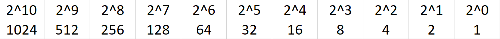

# 2.1 数の表し方(基数)

## 10 進数

私たち人間は**10 進数(decimal、基数 10)**を使います。  
10 進数には 0, 1, 2, 3, 4, 5, 6, 7, 8, 9 があります。  
243 を 10 進数で表すと次のようになります:  
243 = (102 *2) + (101* 4) + (100 * 3) = 200 + 40 + 3.

10 進数は、12d のように接尾辞 "d" を付けて表すことがあります。

## 7 進数

これはどんな基数にも当てはめられます。たとえば、7 進数の 243 は次のとおりです:  
243(7 進数) = (72 *2) + (71* 4) + (70 * 3) = 98 + 28 + 3 = 129(10 進数).

7 進数には 0, 1, 2, 3, 4, 5, 6 があります。  
9 は 7 進数にはないので、7 進数ではどう表すのでしょうか?  
9(10 進数) = (71 ***<u>1</u>**</u>) + (70* **<u>2</u>**</u>) = 7 + 2. 答えは 12(7 進数) = 9(10 進数) になります。

## 2 進数(Base2/Binary)

では 2 進数はどうでしょうか? 2 進数には 0 と 1 があります。基数を分解して考えると分かりやすくなります:  
210 = 1024, 29 = 512, 28 = 256, 27 = 128, など。

  

2 進数への変換や、さまざまな基数の評価の仕方を学びたい場合は、こちらを見てください:

<https://www.khanacademy.org/math/algebra-home/alg-intro-to-algebra/algebra-alternate-number-bases/v/number-systems-introduction>

これを言葉だけで説明するのは少し難しいのですが、この動画はとても分かりやすく説明しています。私の手間も省けます。

2 進数は、110b のように接尾辞 "b" を付けて表すことがあります。

## 16 進数(Hexadecimal)

Hexa = 6, Dec = 10 です。**16 進数は基数 16** です。  
16 進数もよく似ていますが、人によっては少し分かりにくいかもしれません。私たちには、個別の数字が 10 個(0, 1, 2, 3, 4, 5, 6, 7, 8, 9)しかありません。16 進数には 16 個の数字が必要です。0, 1... 11, 12, 13... を使うこともできますが、非常に紛らわしくなります。たとえば、1432 は 1,4,3,2 でしょうか、それとも 14,3,2 でしょうか? 9 より大きい数を表す必要があるときは、16 進数の場合、代わりに A, B, C, D, E, F の文字を使えます。

A = 10, B = 11, ..., F = 15

16 進数には、通常は接頭辞 "0x" か接尾辞 "h" を付けます。たとえば 0xFF や FFh です。

0x4A = (161 *4d) + (160* 10d) = 64d + 10d = 74d.

16 進数についてさらに学ぶには、こちらを見てください:

<https://www.khanacademy.org/math/algebra-home/alg-intro-to-algebra/algebra-alternate-number-bases/v/hexadecimal-number-system>

## 接頭辞と接尾辞

異なる数の表し方を区別するために、接頭辞や接尾辞を使います。区別に使われるものは数多くありますが、ここでは最も一般的なものだけを示します。  

* 10 進数は**接尾辞 "d"** で表すか、何も付けません。例: 12d または 12。
* 16 進数は**接頭辞 "0x"** または**接尾辞 "h"** で表します。例: 0x12 または 12h。16 進数のもう 1 つの表し方に、接頭辞 "\x" を使うものがあります。ただし、これは通常バイト単位で使います。16 進数の 2 桁で 1 バイトになります。例: \x12 や \x12\x45\x21。ビットやバイトが少し分かりにくくても、すぐに説明するので心配はいりません。
* 2 進数は**接尾辞 "b"** または**先頭のゼロ埋め**で表します。例: 100101b または 00100101。先頭をゼロで埋めるのは、10 進数がゼロから始まることはないためで、よく使われます。

[<- 前のレッスン](2.0%20BinaryBasics.md)  
[次のレッスン ->](2.2%20ASCII.md)  

[章のトップ](2.0%20BinaryBasics.md)  
