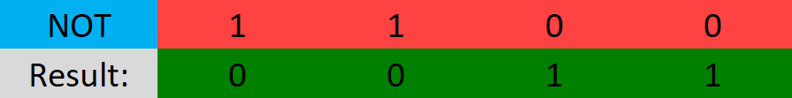
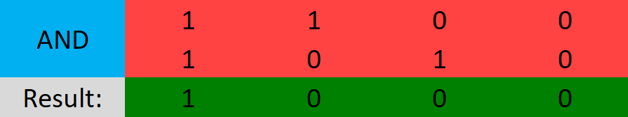
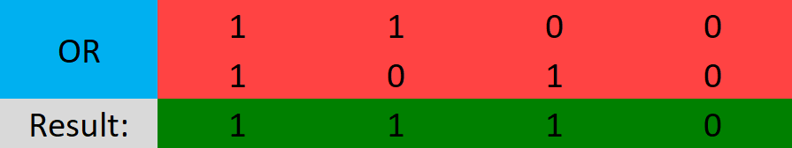

# 2.5 演算

知っておくべきバイナリの演算がいくつかあります。講座全体を通して見るように、これらはさまざまな用途に使われます。

これらの演算には **NOT**、**AND**、**OR**、**XOR** があります。

### NOT

**NOT** は単にビットを反転させます。言い換えると、ビットを「そうではないほう」に変えます。  

* NOT 1 = 0
* NOT 0 = 1

  

### AND

**AND** は両方のビットが 1 かどうかを調べ、そうであれば結果は 1、そうでなければ 0 になります。

* 1 AND 1 = 1
* 1 AND 0 = 0
* 0 AND 0 = 0

  

### OR

**OR** はどちらかのビットが 1 かどうかを調べ、そうであれば結果は 1 になります。

* 1 OR 1 = 1
* 1 OR 0 = 1
* 0 OR 0 = 0

  

### XOR

**XOR** はどちらかのビットが 1 かどうかを調べ、**ただし両方は不可**で、そうであれば結果は 1 になります。

* 1 XOR 1 = 0
* 1 XOR 0 = 1
* 0 XOR 0 = 0

  

[<- 前のレッスン](2.4%20ProgrammingLanguages.md)  
[次のレッスン ->](2.6%20Mindset.md)  

[章のトップ](2.0%20BinaryBasics.md)  
