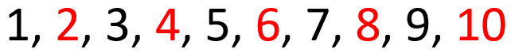

# 2.6 心構え

適切な心構えを持つことは、とても役に立ちます。理解しておくべきなのは、コンピューターは極めて愚かだということです。純粋な論理で動作し、何も仮定しません。

これを示すために、コンピューターに「1 から 10 までの数を書いて、偶数はすべて赤にして」と指示したとします。  
次のような結果を期待するかもしれません:

  

これは正しく見えます。期待どおり、偶数はすべて赤です。

コンピューターは、次のような結果を出すこともあります:

  

これも、リストは有効で、ルールに従っています。偶数はすべて赤です。

これでひどく混乱する人もいます。頭の中でルールを逆にして、赤い数はすべて偶数だと考えてしまうからですが、私たちがコンピューターに伝えた内容からすると、それは正しくありません。コンピューターは、人間のようにルールを逆にしたり、何らかの仮定を置いたりしません。

実は、ルールは奇数については何も定めていないので、奇数は好きな色にできます!

  

9 はどこへ行ったのでしょうか? コンピューターがミスをして 9 を書き忘れたに違いない...と思いきや、そうでしょうか? もしかすると、コンピューターは 9 を白にして、背景に溶け込んでいるのかもしれません。これを禁じるルールはないので、完全に有効です。

## プロトコルとは?

TCP、UDP、HTTP(S)、FTP、SMTP はすべてプロトコルです。なぜでしょうか? プロトコルとは何でしょうか? プロトコルとは、どこにどんなデータがあるかを指定するために使う、単なるテンプレートです。例を使って説明しましょう。
> 01011990JohnDoe/0/123MainSt

これは何でしょうか? 何らかのガイドやテンプレートがなければ、データがごちゃ混ぜになっているだけに見えます。私たちは人間なので、名前や通りなどの情報はおそらく拾い出せます。しかし、コンピューターにはそれができませんし、私たち人間もすべてを理解できるわけではありません。実は、これは "John Doe" という人物についての有用なデータの集まりです。できるだけ小さくしようとして全部を詰め込んでいるので、分かりにくいのです。では、秘密の公式を教えましょう:
> BIRTHDAY(MMDDYYYY)NAME/NumOfChildren/HomeAddress

どうでしょう、これで意味が分かります! 先頭の数字のまとまりは誕生日です。誕生日の後ろは名前です。その後にスラッシュがあり、子供の数が続きます。さらにスラッシュがあり、自宅の住所が続きます。もう 1 つ例を示します:
> 03141879AlbertEinstein/3/112MercerSt

これは、プロトコルとは何かをよく示す例です。プロトコルは、そのままでは無意味に見えるデータの並びを、コンピューターが分解するために使えるテンプレートにすぎません。

子供の数と住んでいる通りに使われている区切り文字(スラッシュ)にも注目してほしいと思います。これらのデータは長さが変わるので、特定の文字数以外の方法で区別するのが良い考えです。コンピューターは仮定を置けないことを思い出してください。非常に文字どおりに指定しないと、こちらの意図が伝わりません。このプロトコルのルールは次のとおりです。テンプレートが正しく記入されていると仮定すると、最初の 8 文字は生年月日を表します。日付の後ろからスラッシュまでの文字は、その人の名前です。次に、そのスラッシュの後ろから次のスラッシュまでの文字は、その人の子供の数です。最後に、最後のスラッシュより後ろの残りのデータは、その人の自宅の住所です。

## 等しいか?

コンピューターは愚かなので、最初は分かりにくい、とても単純な方法で物事を行うことがよくあります。たとえば、コンピューターは 2 つの値が等しいかをどうやって決めているのでしょうか? アセンブリの命令を見始めると、比較(compare)命令が出てきます。この命令は、ある値が別の値より大きいか、小さいか、等しいかを判断できます。この命令は、これらをどうやって判断しているのでしょうか? 実はとても簡単で、引き算をするだけです。あまりに単純なので、最初は気づかないかもしれません。

[<- 前のレッスン](2.5%20BitwiseOperations.md)  
[次のレッスン ->](../Chapter%203%20-%20Assembly/3.0%20Assembly.md)  

[章のトップ](2.0%20BinaryBasics.md)
