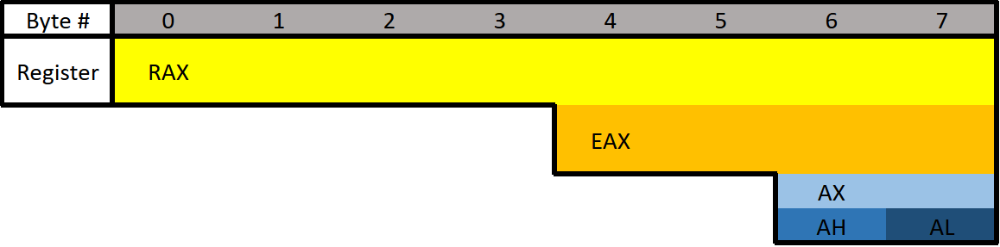

# 3.1 レジスタ(Registers)

64 ビットと 32 ビットのどちらのアセンブリを扱うかによって、少し違いが出ることがあります。すでに述べたとおり、この講座は 64 ビット Windows を中心に扱います。また、x64 アセンブリには、Intel 構文と AT&T 構文の 2 つの構文があります。AT&T 構文は通常 *NIX 系の OS で使われますが、両者は機能的には同じなので、相互に変換できます。この講座では、Intel 構文が最も読みやすく、Windows の標準でもあると考えているので、Intel 構文を中心に扱います。
> x32 の経験はあるが x64 の経験がない場合、レジスタ名が "E" ではなく "R" で始まることに戸惑うかもしれません。これについては後で説明します。

### アセンブリとは?

プログラムをコンパイルすると、コンパイラーはさまざまな処理をします。コンパイラーの最終目標は、高水準のコードを CPU が理解できる言語に変換することです。この言語がアセンブリです。CPU はさまざまな命令をサポートしており、それらが連携して、データの移動、比較の実行、比較に基づく処理、値の変更など、思いつくあらゆることを行います。どのプログラムでも、高水準のソースコードは手元にないかもしれませんが、アセンブリコードは手元にあります。実行ファイルとは、実行できるアセンブリ命令の一覧にすぎません。

### アセンブリと C の比較

人によっては、これがすぐにひどく混乱するかもしれません。覚えておくべきなのは、アセンブリは人間のために書かれたということです。冗長さが少ないだけで、高水準言語とまったく同じようなものです。例:  

```c
if(x == 4){
    func1();
}else{
    return;
}
```

は、機能的に次と同じです

```assembly
mov RAX, x
cmp RAX, 4
jne 5       ; 5行目 (ret)
call func1
ret
```

最初は少し分かりにくく見えるかもしれませんが、すぐに意味が分かるようになります! できれば、自分で一部を読み解いてみてください。アセンブリでは、物事はより短い表記で書かれます。MOV は "move"(移動)の略です。

### レジスタ

**汎用レジスタ(General Purpose Registers、GPR)**について説明します。これは、本質的に変数のようなものだと考えられます。CPU には、極めて高速な独自のデータ保存領域があります。これは便利ですが、CPU 内の容量は極めて限られています。CPU が自分で保持できないデータは、メモリに保存されます。メモリ(RAM)は、CPU にとってずっと低速です。速度が遅いため、CPU は可能であれば、データをメモリではなくレジスタに置こうとします。

#### 主な汎用レジスタは 8 つあります
>
> RSP と RBP 以外の、以下のレジスタがどう使われるかについては、あまり気にしなくてかまいません。RSP と RBP も後で説明するので、心配いりません。

* RAX - **アキュムレータレジスタ**として知られています。関数の戻り値を格納するのによく使われます。
* RBX - **ベースレジスタ**として知られることがあります。メモリアクセスのベースポインタとして使われることがあります。
* RDX - **データレジスタ**として知られることがあります。
* RCX - **カウンタレジスタ**として知られることがあります。ループカウンタとして使われます。
* RSI - **ソースインデックス**として知られています。文字列操作でのソースポインタとして使われます。
* RDI - **ディスティネーションインデックス**として知られています。文字列操作でのディスティネーションポインタとして使われます。
* RSP - **スタックポインタ**です。スタックの先頭(top)のアドレスを保持します。
* RBP - **ベースポインタ**です。スタックの基底(bottom)のアドレスを保持します。

これらのレジスタはすべてデータを保持するために使われます。すぐに指摘しておきたいのは、これらのレジスタは何にでも使えるということです。その「用途」は、単に一般的な慣習です。たとえば、RAX は関数の戻り値を保持するのによく使われます。必ずそうしなければならないわけではなく(実際、そうでないことも多いです)、アセンブリでプログラムを書いているところを想像してみてください。関数の戻り値がどこに入るかが分かっていると非常に助かります。そうでなければ、何のために関数を呼ぶのでしょうか? また、先ほどのアセンブリの例を見てください。そこでは、*x* 変数を格納するのに RAX を使っています。

また、これらのレジスタは何にでも*使える*のですが、通常のデータを扱うときは使わないほうがよいレジスタもあることにも注意してください。たとえば、RSP と RBP は、ほぼ常に、本来設計された用途だけに使うべきです。これらは現在のスタックフレーム(スタックについてはまもなく説明します)の場所を保持しており、これは非常に重要です。RSP と RBP に通常のデータを格納することもできますが、使い終わったときに元の状態に戻せるように、以前の値を保存しておく必要があります。

#### 命令ポインタ

RIP はおそらく最も重要なレジスタです。RIP レジスタは「命令ポインタ(Instruction Pointer)」です。*次に*実行されるコードの行のアドレスです。このレジスタは読み取り専用です(のようなものです)。

#### レジスタの分解

各レジスタは、実際にはより小さなセグメントに分解でき、それらは別のレジスタ名で参照できます。RAX は 64 ビットで、下位 32 ビットは EAX で、下位 16 ビットは AX で参照できます。AX は 8 ビットずつの 2 つの部分に分けられます。AX の上位 8 ビットは AH で参照できます。下位 8 ビットは AL で参照できます。
<p align="center">
  
</p>

RAX は 8 バイトすべて、つまりバイト 0〜7 で構成されます。EAX はバイト 4〜7、AX はバイト 6〜7、AH はバイト 6 だけ、AL はバイト 7(最後のバイト)だけで構成されます。

0x0123456789ABCDEF が RAX のような 64 ビットレジスタに読み込まれた場合、RAX は 0x0123456789ABCDEF を指し、EAX は 0x89ABCDEF、AX は 0xCDEF、AH は 0xCD、AL は 0xEF を指します。0x は実際には存在しません。これは 16 進数を扱っていることを示すためだけに使っています。

"E" と "R" の違いは何でしょうか? **"E" は extended(拡張)の意味**です。**"R" は register(レジスタ)の意味**です。"E レジスタ" は 32 ビットのレジスタであることを覚えておいてください。x32 のアセンブリを見ると、RAX の代わりに EAX が出てきます(x32 には RAX は存在しません)。

すべてのレジスタがどう分解されるかを見るには、こちらを見てください:  
<https://docs.microsoft.com/en-us/windows-hardware/drivers/debugger/x64-architecture>

## さまざまなデータ型

* **浮動小数点値(Floating Point Values)** - float と double。
* **整数値(Integer Values)** - 整数、ブール値、文字、ポインタなど。

データ型によっては、任意のレジスタに入れられるとは限りません。浮動小数点値は整数とは異なる方法で表現されます。そのため、浮動小数点値には専用のレジスタがあります。これらのレジスタには、**YMM0〜YMM15**(64 ビット)と **XMM0〜XMM15**(32 ビット)があります。XMM レジスタは YMM レジスタの下位半分で、EAX が RAX の下位 32 ビットであるのと似ています。これらのレジスタの特徴は、配列として扱えることです。言い換えると、複数の値を保持できます。たとえば、YMM# レジスタはそれぞれ 256 ビット幅で、64 ビットの値を 4 つ、または 32 ビットの値を 8 つ保持できます。同様に、XMM# はそれぞれ 128 ビット幅で、64 ビットの値を 2 つ、または 32 ビットの値を 4 つ保持できます。これらのレジスタをベクトルとして利用するには、特別な命令が必要です。

これらのレジスタの分かりやすい表と、詳しい情報は、こちらにあります: <https://en.wikipedia.org/wiki/Advanced_Vector_Extensions>

### 追加のレジスタ

ほかにも触れておくべきレジスタがあります。これらのレジスタには、特別な用途はありません。**r8〜r15** というレジスタがあり、整数型の値(float や double ではありません)で使われるように設計されています。下位 4 バイト(32 ビット)、2 バイト(16 ビット)、8 ビット(1 バイト)にはそれぞれアクセスできます。これらには、文字 "d"、"w"、"b" を末尾に付けてアクセスします。  
例:

* R8 - 64 ビット(8 バイト)全体のレジスタ。
* R8D - 下位ダブルワード(4 バイト)。
* R8W - 下位ワード(2 バイト)
* R8B - 下位バイト。

[<- 前のレッスン](3.0%20Assembly.md)  
[次のレッスン ->](3.2%20MemoryLayout.md)  

[章のトップ](3.0%20Assembly.md)  

> 浮動小数点レジスタに関する[資料](https://en.wikipedia.org/wiki/Advanced_Vector_Extensions)と情報を提供してくれた [Seelengrab](https://github.com/Seelengrab) に感謝します。
