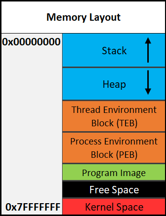
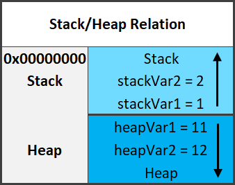
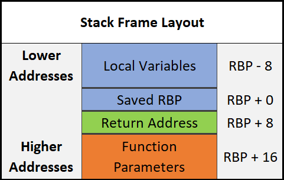
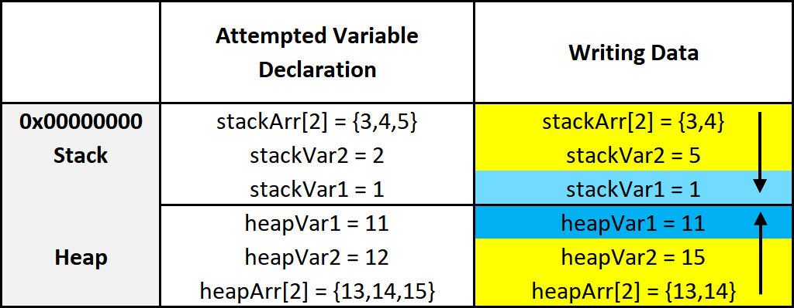

# 3.2 メモリレイアウト(Memory Layout) - 近日更新

システムのメモリは、決まった方法で編成されています。これは、すべてのものに置き場所があるようにするためです。

## アセンブリのセグメント

データやコードが格納される、さまざまなセグメント/セクションがあります。それらは次の順序で配置されています:  

* **スタック(Stack)** - 静的でないローカル変数を保持します。まもなく、より詳しく説明します。
* **ヒープ(Heap)** - *動的に*確保されたデータを含みます。最初は初期化されていないことがあります。
* **.data** - *ゼロ以外の値*に初期化されたグローバルデータと静的データを含みます。
* **.bss** - *初期化されていない、またはゼロに初期化された*グローバルデータと静的データを含みます。
* **.text** - プログラムのコードを含みます(名前は私のせいではありません。私が付けたものではないので)。

## メモリセクションの概要

Windows でメモリがどのように配置されるかの全体像を示します。**これは極端に単純化したものです。**
<p align="center">
  
</p>

### 重要

上の図は、変数(および名前付きのデータ、構造体も含む)がメモリに入れられる、またはメモリから取り出される方向を示しています。実際のデータは、これとは異なる方法でメモリに入れられます。これが、スタックの図がこれほど多様な理由です。スタックとヒープが互いに向かって伸びる図や、上側に高位のメモリアドレスを置く図をよく見かけるでしょう。*これについては後で詳しく説明します*。ここで示している図は、リバースエンジニアリングに最も関連が深いものです。低位のアドレスを上に置くのも、最も現実に近い描き方です。

## 各セクションの説明

* **スタック(Stack)** - 静的なデータの確保に素早く使えるメモリ領域です。低位のアドレスが上、高位のアドレスが下にあるスタックを想像してください。これは通常の番号付きリストと同じです。データは「後入れ先出し(last-in-first-out、LIFO)」で読み書きされます。スタックの LIFO 構造は、積み重ねた皿でよく表されます。上から 3 枚目の皿をそのまま取り出すことはできず、そこに届くまで 1 枚ずつ皿を取り除く必要があります。アクセスできるのはスタックの一番上にあるデータだけなので、ほかのデータにアクセスするには、上にあるものをどける必要があります。スタックが静的なデータを保持すると言ったとき、整数のように長さが分かっているデータのことを指しています。整数のサイズはコンパイル時に決まり、通常は 4 バイトなので、それをスタックに置けます。最大長が指定されていない限り、ユーザー入力はサイズが可変なので、ヒープに格納すべきです。*ただし*、その入力のアドレス/場所は、後で参照するためにスタックに格納されることがおそらくあります。データをスタックの一番上に置くことを、スタックに**プッシュ(push)**すると言います。**データがスタックにプッシュされると、スタックは上、つまり低位のメモリアドレスに向かって伸びます。**スタックの一番上からデータを取り除くことを、スタックから**ポップ(pop)**すると言います。**データがスタックからポップされると、スタックは下、つまり高位のアドレスに向かって縮みます。**これはすべて奇妙に思えるかもしれませんが、小さい数字の 1 が上、大きい数字の 10 が下にある、通常の番号付きリストのようなものだと思い出してください。スタックを追跡するために 2 つのレジスタが使われます。**スタックポインタ(RSP/ESP/SP)**はスタックの先頭を追跡するために使われ、**ベースポインタ(RBP/EBP/BP)**はスタックの基底/底を追跡するために使われます。つまり、データがスタックにプッシュされると、スタックが低位のアドレスに向かって伸びたので、スタックポインタは減少します。ベースポインタは、スタックに何かをプッシュまたはポップしても、変わる理由がありません。スタックポインタとベースポインタについては、今後もっと説明します。

> スタックが逆向きに描かれていることもあるので注意してください。ただし、私が教えている向きが、実際に目にするものです。

* **ヒープ(Heap)** - スタックに似ていますが、動的な確保に使われ、アクセスが少し遅くなります。ヒープは通常、動的な(変化する、または予測できない)データに使われます。構造体やユーザー入力のようなものがヒープに格納されることがあります。データのサイズがコンパイル時に分からない場合、通常はヒープに格納されます。**ヒープにデータを追加すると、高位のアドレスに向かって伸びます。**
* **プログラムイメージ(Program Image)** - メモリに読み込まれたプログラム/実行ファイルです。Windows では、通常これは **Portable Executable (PE)** です。

> TEB と PEB については、今のところあまり気にしなくてかまいません。ここでは簡単に紹介するだけです。

* **TEB** - **Thread Environment Block (TEB)** は、現在実行中のスレッドに関する情報を格納します。
* **PEB** - **Process Environment Block (PEB)** は、プロセスと読み込まれたモジュールに関する情報を格納します。PEB が含む情報の 1 つが "BeingDebugged" で、現在のプロセスがデバッグされているかどうかの判定に使えます。  
PEB 構造体のレイアウト: [https://docs.microsoft.com/en-us/windows/win32/api/winternl/ns-winternl-peb](https://docs.microsoft.com/en-us/windows/win32/api/winternl/ns-winternl-peb)

スタックとヒープに、いくつかのデータが載っている簡単な図の例です。
<p align="center">
  
</p>

上の図では、`stackVar1` は `stackVar2` より先に作られています。ヒープの変数も同様です。

## スタックフレーム(Stack Frames)

スタックフレームは、関数のためのデータのかたまりです。このデータには、ローカル変数、保存されたベースポインタ、呼び出し元の戻りアドレス、関数のパラメータが含まれます。次の例を考えてみましょう:

```c
int Square(int x){
    return x*x;
}
int main(){
    int num = 5;
    Square(5);
}
```

この例では、最初に `main()` 関数が呼び出されます。`main()` が呼び出されると、そのためのスタックフレームが作られます。`Square()` を関数呼び出しする前の `main()` のスタックフレームには、ローカル変数 `num` と、渡されたパラメータが含まれます(この場合、main に渡されるパラメータはありません)。`main()` が `Square()` を呼び出すとき、ベースポインタ(RBP)と戻りアドレスの両方が保存されます。ベースポインタはスタックの基底/底を指していることを思い出してください。ベースポインタが保存されるのは、関数が呼び出されると、ベースポインタがその関数のスタックの基底を指すように更新されるからです。関数が戻ると、ベースポインタは復元され、呼び出し元のスタックフレームの基底を指すようになります。戻りアドレスが保存されるのは、関数が戻ったときに、プログラムがどこから実行を再開すればよいかが分かるようにするためです。戻りアドレスは、関数呼び出しの次の命令です。したがって、この場合の戻りアドレスは `main()` 関数の終わりです。これは分かりにくく聞こえるかもしれませんが、次の例で明確になるでしょう:

```asm
mov RAX, 15 ;RAX に 15 を代入
call func   ;func を呼び出す。func(); と同じ
mov RBX, 23 ;RBX に 23 を代入。この行が、関数呼び出しの戻りアドレスとして保存される
```

これが少し分かりにくいことは承知していますが、仕組みはとても単純です。最初は直感的でないだけです。これは単に、関数が戻ったときにどこへ行くか(どの命令を実行するか)をコンピューターに伝えているだけです。関数を呼び出した命令を実行させたくないのは、無限ループになってしまうからです。このため、戻りアドレスには代わりに次の命令が使われます。上の例では、RAX に 15 が設定され、次に `func` という関数が呼び出されます。それが戻ると、戻りアドレスである、`mov RBX, 23` を含む行から実行が始まります。

スタックフレームのレイアウトは次のとおりです:
<p align="center">
  
</p>
各要素の位置に注目してください。これは今後役に立ちます。

> このレッスンが分かりにくかった場合は、[3.3 Instructions](3.3%20Instructions.md) を読んでから、このレッスンをもう一度読んでください。申し訳ありませんが、これらはすべて関連しているので、これを教えるのに適した順序がありません。

## エンディアン(Endianness)

0xDEADBEEF という値は、メモリにどのように格納すべきでしょうか? これは長い間議論されてきたことで、今日でも論争が起きます。最初は、そのまま格納するのが直感的に思えるかもしれませんが、コンピューターの視点で考えると、それほど単純ではありません。このため、コンピューターがデータをメモリに格納する方法には、ビッグエンディアン(big-endian)とリトルエンディアン(little-endian)の 2 つがあります。

* ビッグエンディアン - **最上位**のバイト(一番左)が最初に格納されます。例では 0xDEADBEEF になります。
* リトルエンディアン - **最下位**のバイト(一番右)が最初に格納されます。例では 0xEFBEADDE になります。

さらに学ぶためのリソースはこちらです:  

* <https://www.youtube.com/watch?v=seZLUbgbB7Y>
* <https://www.youtube.com/watch?v=NcaiHcBvDR4>

## データの格納

約束どおり、データがメモリにどう書き込まれるかを説明します。これは、データのための領域がどう確保されるかとは少し異なります。簡単に復習すると、変数のための領域は、下から上へ、つまり高位のアドレスから低位のアドレスへ向かって確保されます。データは、この確保された領域に、ごく単純に入れられます。英語を書くのと同じで、左から右、上から下です。最初のデータは最も低いアドレスにあります。データの位置は、変数の最初のバイトのアドレス(**ベースアドレス**、または単にアドレスと呼ばれます)からどれだけ離れているかに基づいて参照されます。

たとえば、12345678 というデータがあるとします。要点を強調するために、各数字が 2 バイトだとしましょう。この情報から、1 はオフセット 0x0、2 はオフセット 0x2、3 はオフセット 0x4、4 はオフセット 0x6、というようになります。

繰り返しますが、これはごく単純な概念ですが、確実に理解しておく必要があります。

これをすべて言い換えると、データは、変数の領域が確保される向きとは逆の向きで、確保された領域に入れられる、ということです。

<p align="center">
  
</p>

この図は 2 つのことを示しています。1 つ目は、データが確保された領域にどのように入れられるかです。2 つ目は、データが確保されたメモリに入れられる方法の副作用です。図を分解して説明します。左側は、作成される変数です。右側は、それらの変数が作成された結果です。ここでは、とりあえずスタックだけに注目します。ヒープはそこから推測できます。

* 左側では、3 つの変数に値が与えられています。最初の変数は、前に説明したように、一番下に置かれます。次の変数はその上に置かれ、その次はさらにその上に置かれます。
* 変数の領域を確保した後、それらの変数にデータが入れられます。すべてごく単純ですが、配列では興味深いことが起きています。2 要素の配列しか確保されていないのに、3 つ与えられていることに注目してください。データは低位のアドレスから高位へ、つまり左から右、上から下へ書き込まれるので、下にある変数のデータを上書きします。そのため、`stackVar2` は 2 ではなく、`stackArr[2]` に入るはずだった 5 で上書きされます。

これですべて理解できたでしょうか。簡単に復習します:

変数は、トレイを積み重ねるように、スタックに 1 つずつ上に重ねて確保されます。つまり、高位のアドレスから低位のアドレスへ向かってスタックに置かれます。

データは、変数に、左から右、上から下へ入れられます。つまり、低位から高位のアドレスへです。

これは単純な概念です。私が長い説明をしたからといって、複雑に考えすぎないでください。理解することが不可欠なので、この概念の説明にこれだけ時間をかけました。これらの概念があるために、世の中には、向きの異なるメモリの図が非常にたくさんあるのです。

## x64 での RBP と RSP

x64 では、RBP が従来とは異なる使い方をされることがよくあります。ローカル変数や関数パラメータなど、スタック上のデータを指すのに RSP だけが使われ、RBP は(RAX と同様に)汎用のデータに使われることがあります。これについては、後でさらに詳しく説明します。

[<- 前のレッスン](3.1%20Registers.md)  
[次のレッスン ->](3.3%20Instructions.md)  

[章のトップ](3.0%20Assembly.md)  
