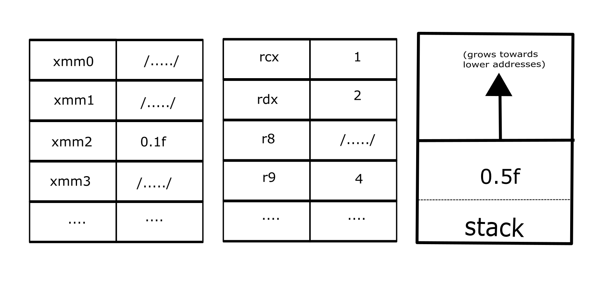

# 3.5 Windows x64 呼び出し規約(Calling Convention)

関数を呼び出すとき、理論上は、パラメータをレジスタ、スタック、あるいはディスク経由で渡すこともできます。呼び出す関数が、どのように呼び出されているかを知っていることだけ確実にすれば十分です。自分で作った関数を使っている限り、これはそれほど大きな問題ではありませんが、ライブラリを使い始めると収拾がつかなくなります。この問題を解決するために、**呼び出し規約(calling convention)**があります。呼び出し規約は、関数にパラメータをどう渡すか、ローカル変数の領域を誰が確保するか、スタックを誰が片付けるかを定義します。

> **呼び出される側(callee)**は呼び出される関数を指し、**呼び出し元(caller)**は呼び出しを行う関数です。

呼び出し規約には、cdecl、syscall、stdcall、fastcall など、さまざまなものがあります。この講座では x64 Windows でリバースエンジニアリングを行うので、主に x64 fastcall を扱います。DLL の章に入ると、cdecl も知っておく必要があります。ほかのプラットフォームでリバースするつもりなら、その呼び出し規約を必ず学んでください。

> 呼び出し規約の名前の前に、アンダースコア 2 つの接頭辞(__)が付いているのをよく見かけます。例: __fastcall。必要ないので、私はこれを付けません。

## Fastcall

Fastcall は、x64 Windows の*唯一の*呼び出し規約です。Windows は、デフォルトで 4 レジスタの fastcall 呼び出し規約を使います。Fastcall は関数のパラメータを後ろから(右から左へ)プッシュします。呼び出し規約について話すと、「アプリケーションバイナリインターフェース(Application Binary Interface、ABI)」というものを耳にします。ABI は、呼び出し規約、パラメータの扱いなど、プログラムのさまざまなルールを定義します。

### x64 Windows の呼び出し規約はどのように動作するか

* 最初の 4 つの引数/パラメータはレジスタで渡されます。浮動小数点値(float や double)*ではない*パラメータは、RCX、RDX、R8、R9(この順)で渡されます。浮動小数点ではない値には、ポインタ、整数、ブール値、文字などが含まれます。浮動小数点のパラメータは、XMM0、XMM1、XMM2、XMM3(この順)で渡されます。浮動小数点値には、float と double が含まれます。渡すパラメータが大きすぎてレジスタに収まらない場合は、参照渡しされます。パラメータが複数のレジスタにまたがることはありません。それ以外のパラメータはスタックに置かれます。
* さて、簡単ですね。では、引数が混在している場合はどうでしょうか? 同じ関数に整数と float の両方の引数を渡す必要がある場合はどうなるでしょうか? 例を示すのが最も分かりやすいので、次の関数があるとします:

```cpp
void func(int a, int b, float c, int d , float e){
//何か処理をする...
return;
}
```

そして、これらの値を渡したとします:

```cpp
int main(){
func(1,2,0.1f,4,0.5f);
}
```



* 簡単に言うと、引数を渡すときは、まずそのデータ型を判断します。次に、その特定のデータ型に割り当てられたレジスタだけを考えます(`float` なら `xmm0` から `xmm3`)。引数は、そのデータ型の並びの中での引数の位置に従って配置されます(この例では、`0.1f` は 3 番目の位置にあるので、3 番目のレジスタ `xmm2` で渡されます)。
* 同様に、引数 `d`(値は 4)については、データ型が `int` であることを確認します。次に、引数リストでの位置が 4 番目であることを確認します。したがって、値 4 は 4 番目の整数レジスタ、つまり `r9` に格納されます。

## シャドウスペース(Shadow Space)

すべてのパラメータには、レジスタ経由で渡されるものであっても、スタック上にそのための領域が予約されます。また、パラメータが渡されない場合でも、スタック上には常に 4 つのパラメータ分の領域が作られます。この領域は完全に無駄になるわけではなく、コンパイラーが使うことができ、実際によく使います。この領域は*シャドウスペース*または*ホームスペース*と呼ばれます。Windows x64 の呼び出し規約は、あらゆる関数呼び出しの前に 32(0x20)バイトの領域を空けておくことを義務づけています。

アセンブリでは、次のような行を見かけることがあります:

 `SUB RSP, 0x20`

これはシャドウスペースの確保が行われているところで、関数が呼び出されようとしていることを示しています。`add` ではなく `sub` なのは、[[3.2 MemoryLayout]] で説明したように、スタックは低位のアドレスに向かって伸びるからです。

## x64 Windows の呼び出し規約

* ベースポインタ(RBP)は、復元できるように保存されます。
* 関数の戻り値は、整数、bool、char などの場合は RAX、float または double の場合は XMM0 で渡されます。
* メンバー関数(クラス/構造体の一部である関数)には、暗黙の最初のパラメータとして "this" ポインタがあります。これはポインタなので、RCX で渡されます。[[1]](https://www.gamasutra.com/view/news/171088/x64_ABI_Intro_to_the_Windows_x64_calling_convention.php)
* *呼び出し元*は、*呼び出される側*のためにパラメータ用の領域を確保する責任があります。呼び出し元は、パラメータが渡されない場合でも、常に 4 つのパラメータ分の領域を確保しなければなりません。
* レジスタ RAX、RCX、RDX、R8、R9、R10、R11 は揮発性(volatile)と見なされ、関数呼び出しで破壊されたものと見なさなければなりません(プログラム全体の最適化のような分析によって安全だと証明できる場合を除きます)。
レジスタ RBX、RBP、RDI、RSI、RSP、R12、R13、R14、R15 は不揮発性(nonvolatile)と見なされ、それらを使う関数が保存して復元しなければなりません。[[2]](https://docs.microsoft.com/en-us/cpp/build/x64-calling-convention?view=vs-2019)

## スタックへのアクセス

ローカル変数や関数パラメータのようなスタック上のデータには、RBP や RSP を使ってアクセスすることがよくあります。x64 では、パラメータに RBP ではなく RSP を使うことが極めて一般的です。最初の 4 つのパラメータは、レジスタ経由で渡されるものの、それでもスタック上にそのための領域が予約されている(*シャドウスペース*)ことを思い出してください。この領域は 32 バイト(0x20)で、4 つのレジスタそれぞれに 8 バイトです。

* パラメータが 1〜4 個の場合:
  * 引数は、それぞれのレジスタ経由で渡されます。コンパイラーは、RSP+0x0 から RSP+0x18 を、おそらくほかの目的に使います。
* パラメータが 4 個を超える場合:
  * 最初の 4 つの引数はレジスタ経由で渡され、残りはオフセット RSP+0x20 から始まるスタックにプッシュされます。これにより、RSP+0x20 が 5 番目の引数、RSP+0x28 が 6 番目の引数になります。
  * 注: 引数 1〜4 は、デフォルトではスタックにプッシュされず、そのための領域が確保されるだけです。4 つを超える引数が渡されるとき、最初の 4 つの引数が、呼び出される側によってスタックに置かれることが*あります*。これに注意してください。

次は、数値 1 から 8 を、ある関数から別の関数に渡す、ごく単純な例です。置かれる順序に注目してください。

```asm
MOV DWORD PTR SS:[RSP + 0x38], 0x8
MOV DWORD PTR SS:[RSP + 0x30], 0x7
MOV DWORD PTR SS:[RSP + 0x28], 0x6
MOV DWORD PTR SS:[RSP + 0x20], 0x5
MOV R9D, 0x4
MOV R8D, 0x3
MOV EDX, 0x2
MOV ECX, 0x1
CALL function
```

見てのとおり、最初のいくつかのパラメータは、通常どおり ECX(RCX レジスタ全体は不要なため)、EDX、R8D、R9D で渡されます。残りのパラメータは、RSP+0x20、RSP+0x28 などを通して渡されます。

## スタックのアラインメント(Stack Alignment)

呼び出し規約は、もう 1 つ重要なことを義務づけています。スタックポインタ `rsp` は、あらゆる関数呼び出しの前(具体的には `call` 命令の前)に、**16 バイト(0x10)境界にアラインされて**いなければなりません。つまり、`rsp` の値は常に 16 の倍数でなければなりません。プログラムが開始されたときは、通常 `rsp` は正しくアラインされているので、すぐには問題になりません。

しかし、`call` 命令は 8 バイトのアドレスをスタックにプッシュします。`call` の前に `rsp` が 16 バイト境界にアラインされていると、8 バイトをプッシュすることで `rsp` は 8 バイト境界になります。これは 16 バイトのアラインメントの条件を破ります。そのため、再びアラインされるように、`rsp` に 8 バイトを加える(または減らす)ことがあります(`call` によるプッシュ 8 + 手動で減算した 8 = 16 バイト)。もう一度 `call` を実行するつもりなら、これを行う必要があり、通常は必要になります。

> これは追加の知識として載せています。これからプログラムをリバースしていて、`call` の後にこれを見かけたら: `sub rsp,8` 、その理由が分かります。

## さらに学ぶには

これが x64 Windows の fastcall 呼び出し規約です。最初の呼び出し規約を学ぶことは、最初のプログラミング言語を学ぶことに似ています。最初は複雑で気後れしますが、実際にはとても単純です。通常、最初の呼び出し規約を学ぶほうが、2 つ目や 3 つ目を学ぶより難しいものです。

この呼び出し規約についてさらに学びたい場合は、こちらを見てください:  
<https://docs.microsoft.com/en-us/cpp/build/x64-calling-convention?view=vs-2019>  
<https://docs.microsoft.com/en-us/cpp/build/x64-software-conventions?view=vs-2019>  

> このレッスンが分かりにくかった場合は、[3.3 Instructions.md](3.3%20Instructions.md) を読んでから、このレッスンをもう一度読んでください。申し訳ありませんが、これらはすべて関連しているので、これを教えるのに適した順序は実際にはありません。

### cdecl (C Declaration)

* パラメータは*スタック*上に後ろから(右から左へ)渡されます。
* ベースポインタ(RBP)は、復元できるように保存されます。
* 戻り値は EAX で渡されます。
* スタックは呼び出し元が片付けます。これが cdecl を特別なものにしています。呼び出し元がスタックを片付けるので、cdecl では可変個数のパラメータが可能です。

それほど難しくなかったでしょう? cdecl はかなり簡単で、これは 2 つ目の呼び出し規約なので、*多くの*詳細を省けます。

[<- 前のレッスン](3.4%20Flags.md)  
[次のレッスン ->](3.6%20FinalNotes.md)  

[章のトップ](3.0%20Assembly.md)  

### 出典

* <https://docs.microsoft.com/en-us/cpp/build/x64-software-conventions?view=vs-2019>
* <https://docs.microsoft.com/en-us/cpp/build/x64-calling-convention?view=vs-2019>
* <https://docs.microsoft.com/en-us/cpp/build/prolog-and-epilog?view=vs-2019>
* <https://www.gamasutra.com/view/news/171088/x64_ABI_Intro_to_the_Windows_x64_calling_convention.php>
