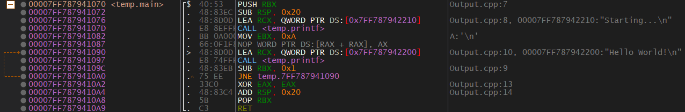
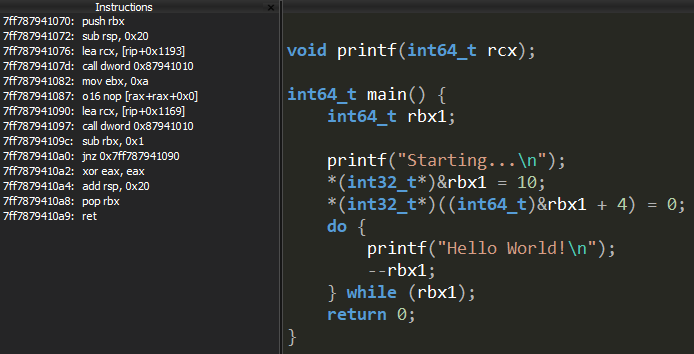

# 4.1 ツールの種類

## デバッガー(Debugger)

デバッガーについては、おそらく聞いたことがあるでしょう。デバッガーを使うと、プログラムのコードを 1 行ずつ実行し、何をしているかを分析できます。私たち自身もこれを使います。残念ながら、私たちにはソースコードがないので、代わりにアセンブリを見ることになります。

デバッグの短期集中講座は [4.2 Debugging](4.2%20Debugging.md) にあります。

Visual Studio と x64dbg にはどちらも、デバッガーが組み込まれています。

## 逆アセンブラー(Disassembler)

逆アセンブラーは、バイナリを受け取って、そのアセンブリコードを表示します。逆アセンブラーは、リバースエンジニアリングの根幹です。次は、小さな関数の逆アセンブル結果です:

  

Ghidra と x64dbg は、プログラムを逆アセンブルできます。Visual Studio でも、自分のコードを逆アセンブルした状態で見ることができます。これは、学習やテストに非常に役立ちます。これを有効にしたい場合は、プログラムにブレークポイントを設定してから、デバッグ > ウィンドウ > 逆アセンブル(Debug > Windows > Disassembly)に進みます。  
メモリを見るには、デバッグ > ウィンドウ > メモリ > メモリ #(Debug > Windows > Memory > Memory #)に進みます。

## デコンパイラー(Decompiler)  

デコンパイラーは、コンパイル済みのプログラムを受け取って、元のソースコードに戻そうとします。これらはしばしば不正確ですが、パラメータ、ループ、条件分岐、場合によっては構造体を識別するのに役立ちます。データ型を識別する*助け*としても良い情報源になります(デコンパイラーのデータ型を決して信用せず、追加の助けとしてだけ使ってください)。

逆アセンブラーの部分で示した関数の、デコンパイル結果は次のとおりです:

  

Ghidra と x64dbg には、どちらもデコンパイラーがあります。Ghidra には組み込みのものがあり、x64dbg には "Snowman" というプラグインがあります。

## ビューアー(Viewers)

プログラムやプログラムの一部を表現する方法はいろいろあります。16 進ビューアーやエディターは、プログラムを 16 進数で表示します。プログラムを ASCII として見ようとするプログラムさえあります。

## ユーティリティ(Utilities)

バイナリについて、より多くの情報を集めるために使える、さまざまなツールがあります。たとえば、DUMPBIN は、インポート、エクスポート、ヘッダー、シンボルなどを調べるのに使えます。

これらのツールを理解する最善の方法は、使ってみることです。

## 静的解析と動的解析

* **静的解析(Static Analysis)** - バイナリが実行されていないときに分析することです。言い換えると、ディスク上にあるままのバイナリを見ることです。Ghidra は、主に静的解析に使われるツールです
* **動的解析(Dynamic Analysis)** - バイナリがメモリ上で実行されている間に分析することです。動的解析には、主に x64dbg を使います

 私は、DLLLoader を使って x64dbg で DLL をリバースすることも、静的解析だと考えています。エクスポートされた関数は(決して呼び出されないので)ステップ実行できないからです。
 *DLLLoader* とは、DLL をメモリ(RAM)に読み込む単純なプログラム(.exe)のことで、x64dbg のような動的ツールが DLL にアタッチして分析できるようにします。
 

[<- 前のレッスン](4.0%20Tools.md)  
[次のレッスン ->](4.2%20Debugging.md)  

[章のトップ](4.0%20Tools.md)  
