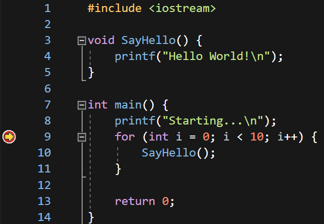

# 4.2 デバッグの短期集中講座

デバッガーを使ったことがなければ、ぜひ試してみてください。使い方を知っておくことは重要です。ここでは、デバッグの短期集中講座を示します。

* **ブレークポイント(Breakpoint)** - ブレークポイントが設定されたコード行で、実行を一時停止します。実行がブレークポイントに到達することを「ブレークポイントにヒットする」と言います。ブレークポイントにヒットすると、ブレークポイントがあるコード行が実行される前に、実行が止まります。次の例では、ブレークポイントにヒットしたとき、9 行目は実行*されません*。9 行目は、ブレークポイントを越えて実行が続行されたときに実行されます。

  

* **ステップ実行(Stepping)** - ステップ実行とは、現在いる行のコードを実行することです。これにより、プログラムを 1 行ずつゆっくり実行し、プログラムが行っているすべてを調べることができます。
* **ステップイン(Step Into)**と**ステップオーバー(Step Over)** - ステップ実行するときは、関数呼び出しの中に入る(ステップイン)か、飛ばす(ステップオーバー)かを選べます。関数呼び出しにステップインすると、呼び出しを追って、その関数をステップ実行できます。関数呼び出しをステップオーバーすると、その関数には入りません。上のコード例で、10 行目の関数呼び出しに*ステップイン*すれば、`SayHello` をデバッグしてステップ実行できます。10 行目の関数呼び出しを*ステップオーバー*すると、`SayHello` 関数には入らず、代わりに 11 行目に直接進みます。
* **ステップアウト(Step Out)** - 関数の途中にいて、そこから出たい場合は、ステップアウトできます。これは、関数の残りを実行して、呼び出された場所に戻ります。

これがデバッグの基本です。ごく単純なプロセスですが、開発者にも、私たちリバースエンジニアにも、極めて重要で役に立ちます。

[<- 前のレッスン](4.1%20ToolTypes.md)  
[次のレッスン ->](4.3%20ToolGuides.md)  

[章のトップ](4.0%20Tools.md)  
