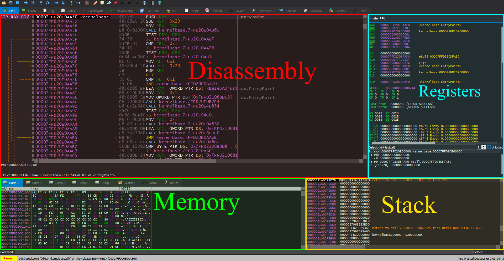
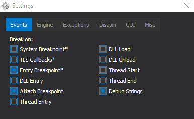
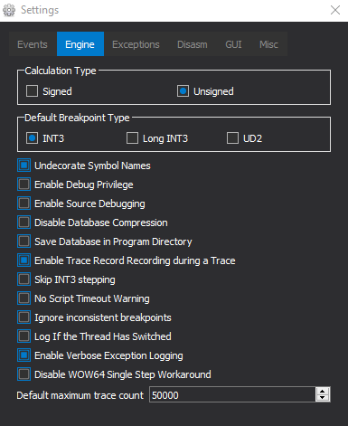
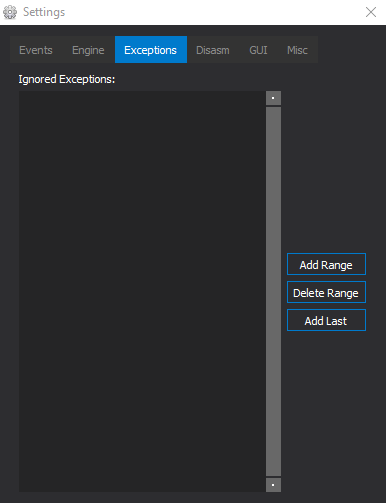
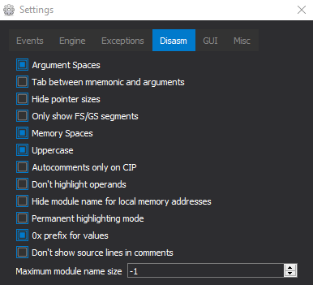
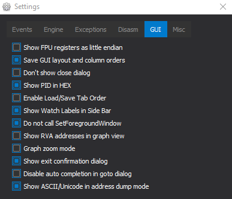
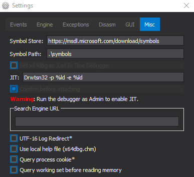
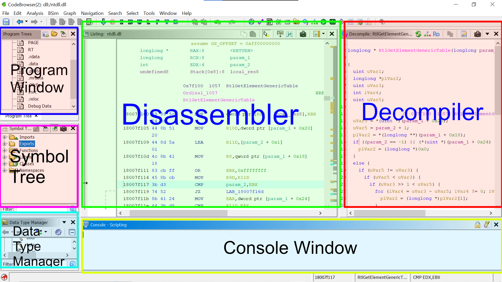

# 4.3 ツールガイド

使っているソフトウェアの使い方を知っておくことは重要です。このレッスンでは、ツールの基本を説明します。ツールが最初に登場したときに、このレッスンをリファレンスとして使うのが最善です。

>  Ghidra と x64dbg をダウンロードすると、通常のインストーラーではなく、ポータブルな `.zip` アーカイブとして提供されていることに気づくでしょう。アナリストは、これらのツールを使い捨ての VM 内や、暗号化された USB から直接実行することが多いため、ソフトウェアは完全に自己完結していなければなりません。通常のインストーラーはシステムに煩雑な変更を加えますが、ポータブルなアーカイブはホストシステムにまったく手を加えません。念のため言っておくと、これらのツールは業界標準の最先端のソフトウェアです。これらのツールを使いこなして、最大限に活用できるなら、自分をプロだと思ってかまいません ;) 。
# x64dbg

  

x64dbg には「解析(Analysis)」という機能があり、逆アセンブルの一部を解析します。この解析により、右側に情報を含むコメントなど、より多くの情報が得られます。さらに優れた解析ができるプラグインに [xAnalyzer](https://github.com/ThunderCls/xAnalyzer) があります。私は使っていて、お勧めしますが、この講座では必須ではありません。

### 主なタブ

x64dbg の上部付近には多くのタブがあり、リバースの助けになります。

* **CPU** は逆アセンブルです。
* **グラフ(graph)**タブは、条件分岐に役立ちます。グラフにするには、グラフ化したい範囲を選択して、右クリックして "Graph" を選ぶか、"G" を押します。
* **Log** は x64dbg のログ情報で、ほとんどすべての場面で無視できません。
* **Notes** ではメモを取れます。グローバルノートは、どのバイナリをリバースしているときにも表示されます。デバギー(debuggee)ノートは、それが書かれた特定のバイナリをリバースしているときにだけ表示されます。
* **Breakpoints** は、設定されたすべてのブレークポイントを表示します。
* **Memory Map** は、メモリ内のセクションと、それがどこにあるかを表示します。
* **Call Stack** は、関数呼び出しと、現在コールスタックにあるものを表示します。
* **SEH** は Structured Exception Handler(構造化例外ハンドラー)の略です。これは、処理されるエラーです。
* **Script** はスクリプト用です。これは無視します。
* **Symbols** は、プログラムのすべてのシンボル、主に関数名を表示します。
* **Source** は、ソースコードがあればそれを表示します。
* **References** は、文字列参照などのあらゆる参照を表示します。このタブは、CPU タブに進み、右クリックして "Search for" または "Find references to" のいずれかを選ぶと、内容が表示されます。
* **Threads** は、そのプロセスに関係する、現在実行中のスレッドを表示します。
* **Snowman** はデコンパイラーです。デコンパイラーに内容を表示するには、CPU ビューでコードの一部を選択して、右クリックして "Decompile" を選びます。Snowman は優れたデコンパイラーではありませんが、悪くもありません。
* **Handles** は、プログラムのすべてのハンドルを表示します。
* **Trace** は、プログラムの一部のトレースを表示します。トレースを取れば、一度トレースしたセクションを「静的にデバッグ」できます。

### メモリウィンドウ

メモリウィンドウには、いくつかの異なるタブがあります。メモリ内の領域である 5 つの「Dump」があります。選んだメモリの一部や変数を監視できる "Watch" タブがあります。"Locals" はローカル変数です。"Struct" では構造体を解析できます。

### スタックウィンドウ

スタックウィンドウは、スタックを表示します。現在のスタックポインタのアドレスは、強調表示されます。

### レジスタウィンドウ

すべてのレジスタを表示します。レジスタを右クリックして、それらに対していろいろ操作できます。

### 保存とデータベース

x64dbg は、進行状況を自動的に保存します。手動で進行状況を保存したい場合は、データベースを使えます。データベースは "File" タブからインポートとエクスポートができます。データベースは、コンピューター間で共有するのにも便利です。

### 設定

私の設定は次のとおりです:

  

  

  

  

  

  

# Ghidra

Ghidra は、NSA の私たちの友人たちが作った、優れたリバースのフレームワークです。私が Ghidra を使う主な理由はデコンパイラーで、ほかのコンパイラーと比べて非常に優れています。

  

x64dbg と違って、Ghidra は非常に密集していて複雑に見えるかもしれません。初心者なら、これらの複雑さをすべて心配する必要はありません。私のアドバイスは、画面に見えるものをすべて理解しようとしないことです。当面は、主にシンボルツリー、逆アセンブラー、デコンパイラーに注目します。
それ以外は、必要になったときに自然に学べます。
### 逆アセンブラー(Disassembler)

ここで逆アセンブルが行われます。このウィンドウは、単にリスティングウィンドウと呼ばれます。
### デコンパイラー(Decompiler)

C のコードが表示される場所で、ここで任意の行をクリックすると、対応するアセンブリの行が表示され、その逆もできます。これはアセンブリを学ぶのに最適です。
### シンボルツリー(Symbol Tree)

すべてのシンボルが、関数、インポート(外部ライブラリから借りてくるコード)、エクスポート(ファイルが共有のために提供するコード)のように、構造化された順序立った方法で分類されています。
### データタイプマネージャー(Data type manager)

このウィンドウでは、ファイル内のデータ型を管理、適用、整理できます。
### プログラムウィンドウ(Program window)

これは、`.text` や `.data` など、ファイルの生のメモリレイアウトを表示します。
### コンソールウィンドウ(Console window)

ここには、実行する自動スクリプトからのエラー、警告、出力が表示されます。

[<- 前のレッスン](4.2%20Debugging.md)  
[次のレッスン ->](../Chapter%205%20-%20BasicReversing/5.0%20BasicReversing.md)  

[章のトップ](4.0%20Tools.md)  
