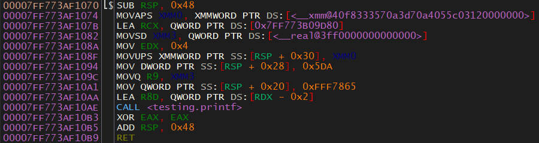

# 5.2 関数呼び出し

## 始める前に

* 以下の例のプログラム名は "Testing.exe" です。このため、いくつかの項目の先頭に "testing.*" が付いているのが見られます。
* パラメータは、決まった順序で設定する必要はありません。RCX は EDX の後に設定しても問題ありません。
* パラメータは、64 ビットのレジスタを通して渡す必要はありません。たとえば、RCX、ECX、CX などを通して渡せます。
* ほかの知っている命令の亜種である、新しい命令が出てきます。たとえば、MOVAPS は新しいものですが、MOV 命令の亜種にすぎません。MOVAPS は、単精度の値を移動するために使われます。**単精度の値は float で、倍精度の値は double です。**ある値のデータ型が正確に何かを突き止めようとしているのでない限り、私はたいてい亜種を無視して、主要な考え方に注目します。言い換えると、MOVAPS が単精度を扱うことは今のところ気にせず、単にデータを移動することだけを気にします。

このレッスンは、バイナリがなくても追えるはずですが、ここでリバースするコードの自分用のバージョンをコンパイルしたい場合は、コードは次のとおりです:

```c
#include <iostream>
int main() {
    printf("Printing with printf(). Here is some data: %d, %d, %f, %p, %d, %f, %f\n", 4, 2, 1.0f, (void*)0xFFF7865, 1498, 87.003f, 99123.34);
    return 0;
}
```

## 関数呼び出しの分析

関数呼び出しを見てみましょう。この場合、呼び出される関数は `printf()` です。
<p align="center">
  
</p>

この関数が実行されると、コンソールに次のように出力されます:  
`Printing with printf(). Here is some data: 4, 2, 1.000000, 000000000FFF7865, 1498, 87.002998, 99123.340000`

## 渡されるパラメータ

これらのパラメータが `printf()` に渡されることが分かるのは、`CALL <testing.printf>` の前にパラメータが設定されているからです。

1. **1 番目**に渡されるパラメータ(RCX)は、メモリアドレス 0x7FF773B09D80 です。これは文字列 "`Printing with printf(). Here is some data: %d, %d, %f, %p, %d, %f, %f\n`" のアドレスです。これが `printf()` のフォーマット文字列です。このフォーマット文字列が `printf()` のパラメータ*である*ことを忘れないでください。
2. **2 番目**に渡されるパラメータ(EDX)の値は 0x4 です。
3. **3 番目**のパラメータ(R8D)は `RDX - 0x2` に設定され、これは 0x2 です。
4. **4 番目**のパラメータ(R9)は XMM3 に設定されます。XMM3 には、メモリアドレス real@3ff000... にある値が入っています。これはメモリアドレスではなく、x64dbg がメモリアドレスに付けている「ラベル」にすぎません。実際のアドレスは 0x7FF773B09DC8 です。このアドレスには 1(double として)が入っています。

> これで、パラメータを渡すためのレジスタは使い切ったので、プログラムはスタックを使う必要があります。

5. **5 番目**のパラメータは、`MOV QWORD PTR SS:[RSP + 0x20], 0xFFF7865` でスタックに置かれます。これが、出力される "000000000FFF7865" の値です。
6. **6 番目**のパラメータは、`MOV DWORD PTR SS:[RSP + 0x28], 0x5DA` でスタックに置かれます。0x5DA は 16 進数で 1498 です。
7. **7 番目**と **8 番目**のパラメータは、`MOVUPS XMMWORD PTR SS:[RSP + 0x30], XMM0` で、同時にスタックに置かれます。XMM レジスタは 2 つの値を保持できることを思い出してください。XMM0 には、87.002998 と 99123.34 の両方が入っています。

この時点で、`printf()` 関数が呼び出されます。`printf()` は、これらのパラメータを受け取って、必要に応じて使います。

以上が関数呼び出しです。今説明したことが理解できれば、ほかのどんな関数呼び出しに出会っても、理解するのにそれほど苦労しないはずです。64 ビット Windows をリバースしていない場合は、呼び出し規約が違う可能性があることを覚えておいてください。

[<- 前のレッスン](5.1%20BeforeWeBegin.md)  
[次のレッスン ->](5.3%20HelloWorld.md)  

[章のトップ](5.0%20BasicReversing.md)  
