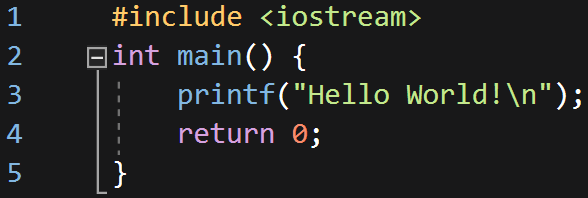
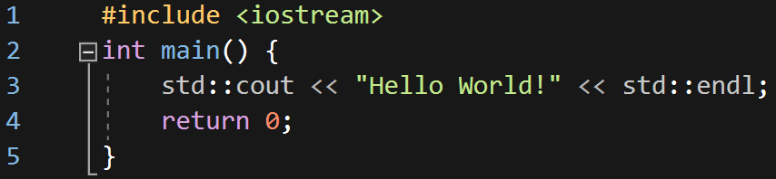
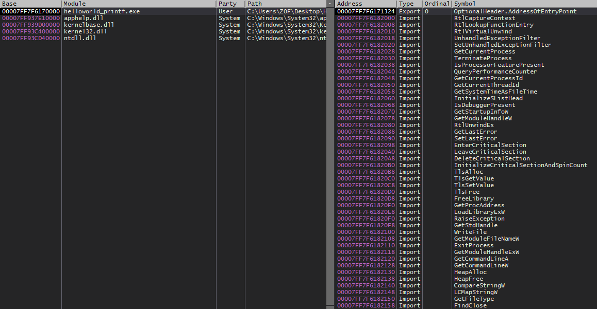
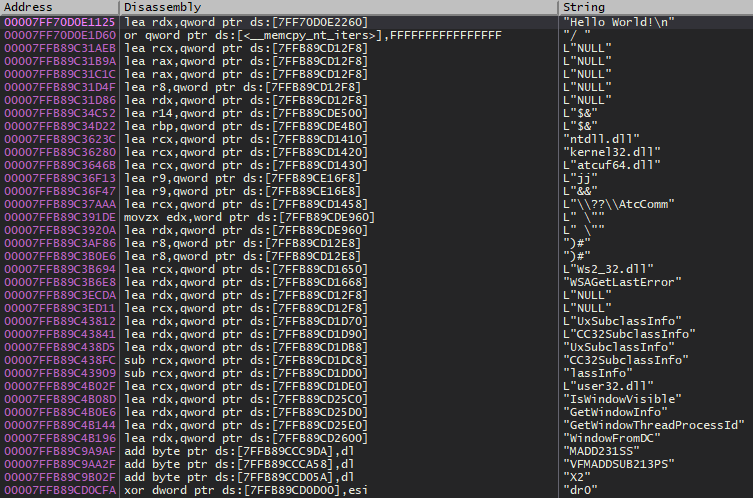
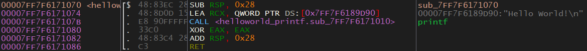
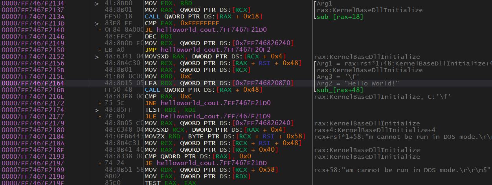
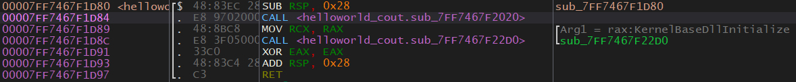
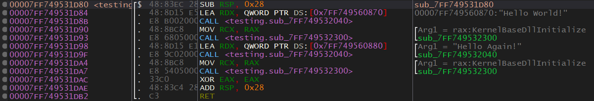

# 5.3 Hello World

"Hello World" プログラムは、[5.2 FunctionCall](5.2%20FunctionCall.md) で扱ったものと、それほど違いません。C++ でプログラムに "Hello World!" を出力させる方法はたくさんありますが、ここでは主な 2 つの方法を示します。1 つは `printf()` を使うもの、もう 1 つは `std::cout` を使うものです。簡単そうに聞こえますが、非常に重要な概念をいくつか扱います。

## ソースコード

### `printf()` を使う場合

<p>
  
</p>

#### `std::cout` を使う場合

<p>
  
</p>

## `printf()` 版のリバース

コンパイルされたプログラムを、逆アセンブラーで見てみましょう。**まず `printf()` 版から始めます。**  
これらのプログラムには x64dbg を使います。うまく表現してくれるからです。x64dbg でプログラムを逆アセンブルするには、File > Open に進んでプログラムを選びます。プログラムを x64dbg の GUI にドラッグ&ドロップすることもできます。

バイナリを最初に x64dbg に入れたとき、`main()` 関数にいないことに気づくかもしれません。実は、コンパイルされるときに、プログラムに多くのものが追加されます。x64dbg の設定によっては、異なる場所から開始することもあります。「エントリポイント」や、セキュリティクッキー周辺から始まることがあります。

* **エントリポイント(Entry Point)** - エントリポイントは、プログラムの本当の始まりです。エントリポイントは、`main()` の*前*に実行されます。`main()` が最初に呼び出されないのは、`main()` が呼び出される前に行う必要がある、ほかの処理(セキュリティクッキーの設定など)があるからです。
* **セキュリティクッキー(Security Cookies)** - セキュリティクッキーは、関数の戻りアドレスをたどる前に、それが破壊されていないことを確認するために使われます。これは、バッファオーバーフローの緩和に役立てるために行われます。私たちにとっては、セキュリティクッキーに関することはすべて無視してかまいません。

### `main()` を見つける

リバースしたいコードがある場所なので、`main()` 関数を見つけたいと思います。では、どうやってそこに行くのでしょうか? 最も簡単な方法は、シンボルを使うことです。シンボルとは、逆アセンブラーが見つけられた名前にすぎません。これらの名前は、通常は関数名です。"Symbols" タブに進んで、実行ファイルをクリックしてください。
<p align="center">
  
</p>

`main()` 関数はないようなので、ほかの方法で見つける必要があります。選択肢の 1 つは、出力される文字列を探すことです。このプログラムが "Hello World!" を出力することは分かっているので、その文字列がどこで使われているかを探してみましょう。x64dbg では、逆アセンブルウィンドウで右クリックして、Search for > All modules > String references に進むとできます。下の画像と似たものが表示されるはずです。

<p align="center">
  
</p>

見てのとおり、かなり多くの文字列があります。これらの文字列のほとんどは重要ではありません。下部の検索バーを使って、"Hello World!" 文字列を検索しましょう。そのまま "Hello World!" 文字列をダブルクリックしてください。複数ある場合は、最初のものを選んでください。すると、その文字列が使われている関数に移動します。

<p align="center">
  
</p>

> ちょっとしたヒント: アドレス列を広げると、関数名が見えます。関数の先頭には、ドル記号("$")も付いています。

この文字列が使われている関数は `sub_7FF7F6171070` です。これは、あなたの環境では違う可能性があります。これはアドレスの横に表示されています(列の幅を変更する必要があるかもしれません)。名前が変なのは、逆アセンブラーが名前を割り出せなかったので、ランダムな名前を付けただけだからです。では、これが `main()` 関数だとどうして分かるのでしょうか? 分かりません。だからリバースはとても難しいのです。私たちはコードが何をするかを知っていて、ソースコードも見られるので、これがおそらく main 関数だと分かります。現実的な状況では、確実なことは実際には分からないでしょう。

何度もこれをしなくて済むように、関数の最初の命令(横に `sub_7FF7F6171070` がある命令)を右クリックして、Label > Label current address を選び、そのラベルを `main` に変更しましょう。これで、functions タブに進んで `main` を検索すれば、戻ってこられます。functions タブには、View > Functions に進むか、"Memory Map" タブの上にあるツールバーの "fx" ボタンをクリックすると移動できます。このツールバーには、デバッグのボタン(青い矢印)もあります。

### main の分析

アセンブリで見ながら、`main()` が何をしているかを突き止めましょう。

<p align="center">
  
</p>

* `SUB RSP, 0x28` - 最初の行で、`RSP` から 0x28 が引かれているのが分かります。これは関数プロローグ(function prologue)の一部です。関数プロローグは関数をセットアップするもので、通常は無視してかまいません。
* `LEA RCX, QWORD PTR DS:[0x7FF7F6189D90]` - `LEA` は **Load Effective Address** の略で、デスティネーションオペランドにアドレスをロードします。この場合、文字列のアドレスが RCX に入れられています。値が RCX に入れられていることに注目してください。RCX は、関数にパラメータを渡すために最初に使われるレジスタです。案の定、次の行は関数呼び出しです。`QWORD PTR` の部分は何でしょうか? これは単に、値が QWORD(8 バイト)で、ポインタであることを示しています。`DS` はデータセグメント(data segment)の略で、レジスタに収まらないデータを格納できます。これは無視して、メモリ内のどこかにあるデータだということだけ知っておけば十分です。この例では、このアドレスは文字列のアドレスです。メモリ内の文字列を見たい場合は、命令を右クリックして、Follow in Dump > Constant: (Address) に進むとできます。
* `CALL <helloworld_printf.sub_7FF7F6171010>` これは `sub_7FF7F6171010` の関数を呼び出します。先ほど分かったように、この関数は 1 つのパラメータ、つまり文字列のアドレスを受け取ります。xAnalyzer のおかげで、この関数が `printf()` であるというコメントが追加されました。もし xAnalyzer がこれを突き止めてくれなかったら、これが `printf()` だとどうやって分かるでしょうか? 通常は複数のツールを使うので、そのうちのどれかが教えてくれるでしょう。次に簡単な方法は、プログラムをデバッグして、呼び出しの後に何が起こるかを見ることです。この呼び出しが、画面に出力されるテキストと関係があることが分かるでしょう。最後に、その関数をリバースして、その方法で突き止めることもできます。

次は関数エピローグ(function epilogue)で、これは関数の終わりです。この部分は、実行を呼び出し元に戻す前に、すべてを片付けます。

* `XOR EAX, EAX` - 何かをそれ自身と XOR すると、ゼロになります。この場合、EAX がゼロクリアされています。なぜ RAX ではなく EAX をゼロにしているのかは分かりません。おそらく RAX は必要なく、EAX だけが必要だったのでしょう。深く調べることもできますが、その必要は実際にはありません。このことから、関数が 0 を返していることが分かります。これに基づいて、関数の型は整数だと推測できます。ソースコードを見ると、これは正しいです。また、`main()` は C/C++ では通常整数型なので、これが `main()` 関数だという推測がさらに裏付けられます。
* `ADD RSP, 0x28` - これは、スタックを関数呼び出しの前の状態に戻しています。最初の `SUB RSP, 0x28` と逆になっていることに注目してください。
* `RET` - 実行を呼び出し元に戻します。これが関数の終わりです。

`printf()` に文字列の*アドレス*を渡したことについて触れておきたいと思います。C/C++ では、文字列は単なる文字の配列です。文字列の終わりは、ヌル文字/ヌルバイト(0x00)で示されます。これは文字列終端(string/null terminator)と呼ばれます。これは重要で、`printf()` のようなものは、これを使って文字列の終わりがどこかを知り、その先を出力しないようにします。C/C++ では、文字列は、最後の文字がヌル終端である文字配列にすぎません。

> 0x00 は多くの名前で呼ばれます。ヌルバイト、ターミネーター、文字列ターミネーター、ヌルターミネーターなどです。

分かりにくくなかったでしょうか。`main()` 関数を見つけるのは面倒なことがあり、リバースを学び始めたばかりの人には、確かに良い印象を与えませんが、やらなければならないことです。少し自由に調べてみてください!

## `std::cout` 版のリバース

ここから面白くなります。`std::cout` は C++ の一部ですが、`printf()` は C の一部です。つまり、コンパイラーは `std::cout` を完全に制御できますが、`printf()` はそれほど制御できません。テキストを画面に*1 回だけ*出力するプログラムを、できるだけ効率的にするにはどうするか、考えてみてください。関数を 1 回だけ呼び出す代わりに、何ができるか考えてください。答えは、関数をまったく呼び出さないことです。出力するテキストを、出力関数の中に入れるか、出力するテキストと一緒に出力関数を置けばよいのです。私たちリバースエンジニアにとって、とても楽しそうに聞こえますよね?!

例を示します:

```c
int Add(int num1, int num2){
    return num1+num2;
}
int main(){
    int total = Add(2, 3);
}
```

これをより効率的にするにはどうすればよいでしょうか? 方法は 2 つあります。  
次の例は、パラメータを渡す必要がないので、より効率的です。

```c
int Add(){
    return 2+3;
}
int main(){
    int total = Add();
}
```

次の例は、関数呼び出しがまったくないので、より効率的です。その代わり、`Add()` 関数のコードが、基本的に `main()` にコピー&ペーストされています。例が非常に小さいのでそうは見えないかもしれませんが、まさにこの例ではそれが起きています。これは(誰に聞くかによって)**関数のインライン化(function inlining)、インライン展開(inline expansion)、または単にインライン化**と呼ばれます。ここでは単にインライン化と呼びます。

```c
int main(){
    int total = 2 + 3;
}
```

### リバースの時間

HelloWorld_Cout.exe を x64dbg で開いて、始めましょう。まず、main 関数を見つけたいと思います。先ほど使ったのと同じ手法、つまり文字列の検索を使いましょう。

<p align="center">
  
</p>

文字列がそこで何をしているのでしょうか? コードを見ると、次に呼び出される関数が、文字列の出力につながると推測できます。また、関数に渡される最初のパラメータが、"KernelBaseDLLInitialize" に関係する何かであることにも注意してください。これは、それが HelloWorld_Cout.exe に実装された関数ではなく、ライブラリの関数であることを示しています。私たちが正しければ、これは何が起きているかを突き止めるのに役立つかもしれません。

文字列を扱っている LEA 命令にブレークポイントを設定しましょう。ブレークポイントは、F2 を押すか、右クリックして Breakpoint > Toggle に進むと設定できます。そして、そのブレークポイントにヒットするまでプログラムを実行します。次に、上部にある対応する青い矢印をクリックするか、F8 を押して、呼び出しをステップオーバーできます。この呼び出しを飛び越えると、コンソールに文字列が表示されます。この時点で、これが `std::cout` かそれに関係するものだという私たちの推測は、極めて正しそうです。でも、今呼び出された関数が、ほかのことをしていないとどうして分かるのでしょうか? テキストをターミナルに出力した関数を調べることができます。その関数は、RAX からのオフセットを通してアクセスされています。このオフセットは 0x48 です。この関数はアドレスで呼び出されていないので、関数を見つけたければ、RAX が何かを知って、オフセットを計算する必要があります。そのため、その時点に到達するまで、もう一度プログラムを実行する必要があります。実行がその行に達したら、RAX が何かが分かります。これで、自分で計算するか、Enter を押して x64dbg に任せて呼び出しをたどってもらうことで、RAX + 0x48 に進みます。ここから、その関数をリバースできます。

何が起きているかを突き止めるもう 1 つの方法は、`std::cout` を使う自分のプログラムを書いて、内容が一致するかを見ることです。グラフビューを使って、リバースしているプログラムの関数のレイアウトと、自分のプログラムのレイアウトが一致するかを見ることもできます。もちろん、個々のアセンブリ命令を見ることもできますが、それは少し面倒だと思います。これは、経験豊富なリバーサーがよく使う手法です。やがて、このようなパターンを目にして、何が起きているかをかなり素早く突き止められるようになります。

### main にたどり着く

では、文字列は `std::cout` に入れられたのでしょうか、それとも `std::cout` が `main()` に入れられたのでしょうか? これを突き止めるのはかなり簡単です。まず、文字列を参照していた命令に戻ります。この関数を呼び出したものを見つけたいのです。この関数の最初の命令に進みます。これは関数のアドレス/場所でもあります。それを右クリックして、Find references to > Selected Address(es) を選びます。この関数が 1 回呼び出されていることが分かるので、その呼び出し元に進みます。これが、呼び出し元です:

<p align="center">
  
</p>

これは非常に小さいので `main()` のようですが、保証はありません。これは私たちの文字列を出力させる関数なので、`main()` かそれに関係するものである可能性が非常に高いです。

これで、この場合は、コンパイラーが文字列を `std::cout` に入れることにしたと分かりました。

2 つ目の呼び出しは何でしょうか? この呼び出しが何かを、自分で突き止めてみることをお勧めします。簡単なヒントです。呼び出される 2 つの関数は、非常によく似ています。  

<details>
  <summary>答え(クリックして表示):</summary>
  
  2 つ目の呼び出しは `std::endl` です。この関数が "\n"、つまり改行文字を出力していることが分かります。
</details>

## `std::cout` を 2 回使う場合

前に述べたとおり、関数が複数回呼び出される場合、インライン化はほとんど使われません。では、`std::cout` が 2 回使われると、どうなるでしょうか? すると、`printf()` 版にずっとよく似たものになります。

<p align="center">
  
</p>

見てのとおり、出力される 2 つの文字列のそれぞれについて、`std::cout` の呼び出しが 1 つ、`std::endl` の呼び出しが 1 つあり、合計で 4 回の関数呼び出しになります。

## `main()` の見つけ方について、さらに

`main()` を見つけるために使える手法がいくつかあります。今後、これらの方法について説明します。1 つ触れておきたいのは、`main()` はエントリ関数の中で呼び出されるはずだということです。main を探しているなら、エントリ関数の末尾から始めて、上に向かって調べていくのが最善です。今のところは以上です。このテーマについては、今後さらに追加します。  

## 最後に  

`printf()` 版は、かなり簡単に理解できるはずです。`std::cout` のほうは、ずっと分かりにくいです。それでも、何が起きているかの大まかなイメージはつかめたと思います。ここからは、自分のプログラムを書いて、何が起きているかを見ることを強くお勧めします。Visual Studio では、プログラムのアセンブルされたバージョンを、ソースコードと一緒に見ることができ、学習に非常に役立ちます。この部分が分かりにくくても、心配はいりません。`std::cout` のことは、本当に奇妙で、直感に反しています。

[<- 前のレッスン](5.2%20FunctionCall.md)  
[次のレッスン ->](5.4%20Loops.md)  

[章のトップ](5.0%20BasicReversing.md)  
