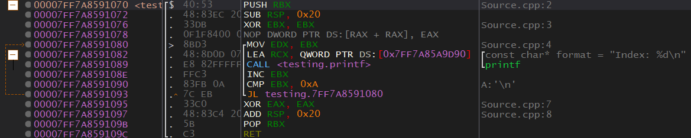
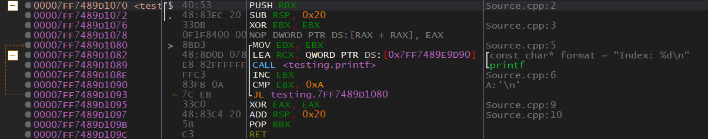

# 5.4 ループ

いくつかのループを見てみましょう。ループはかなり単純ですが、逆アセンブルを流し読みしているだけだと、見逃しやすいものです。バイナリをリバースするとき、ループの目印である "while" や "for" のようなキーワードは見えません。このため、見逃しやすいのです。

## for ループ

<p align="center">
  
</p>

ループを見分ける最も手早い方法は、インデックス/反復カウンターを見つけることです。上の例では、`XOR EBX, EBX` で EBX がゼロクリアされているのが分かります。これは特別なことではありませんが、少し下に進むと、`INC EBX` で EBX がインクリメントされているのが分かります。x64dbg は、(一番左にあるオレンジ色の矢印のような)ループの可能性を示唆する矢印も使います。さて、流し読みはこのくらいにして、実際にループをきちんと見てみましょう。

* まず EBX がゼロクリアされます。これで、このループがゼロから始まることが分かります。EBX をループインデックスと呼ぶことにしましょう。
* EDX にループインデックスが設定されます。
* RCX に文字列が移動されます。
* `printf()` が呼び出されます。RCX(`printf()` に渡される最初のパラメータ)には、文字列 "Index: %d\n" が入っています。EDX(`printf()` に渡される 2 番目のパラメータ)には、ループインデックスが入っています。`printf()` の呼び出しは、次のようなものだと推測できます:  
`printf("Index: %d\n", index);`
* 次に、ループインデックスが 1 増やされます。
* インデックスが 10(0xA)と比較されます。
* インデックスが 10 未満なら、ループを繰り返します。ループの開始は `MOV EDX, EBX` です。

したがって、このループは "Index: %d\n" を 10 回出力します。C/C++ で書くと、次のようになります:

```c++
for (int i = 0; i < 10; i++) {
    printf("Index: %d\n", i);
}
```

## while ループ

次は、前のものと機能的に同じプログラムですが、これは while ループです。

<p align="center">
  
</p>

見てのとおり、while ループは for ループと同じです。

## do-while ループ

do-while ループは、ほとんどの開発者にはあまり使われませんが、コンパイラーは頻繁に生成します。do-while ループは、while ループの中のコードが少なくとも 1 回は実行される点を除いて、while ループと同じです。ほとんどの開発者は、そのように定義していなくても、まさにそうなるループを作っています。前に示した while ループと for ループの例は、どちらも do-while ループで実現できます。性能を改善しようとして、多くのコンパイラーは、for ループや while ループの代わりに do-while ループを使います。これは、ループから比較とジャンプを 1 つ減らせるからです。デコンパイラーを使うと、ほとんどの場合、ループが do-while ループとして表示されます。これが理由です。

[<- 前のレッスン](5.3%20HelloWorld.md)  
[次のレッスン ->](../Chapter%206%20-%20DLL/6.00%20DLL.md)  

[章のトップ](5.0%20BasicReversing.md)  
