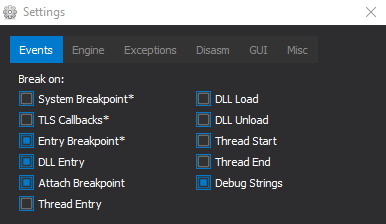

# 6.01 始める前に

## 始める前に

なぜ DLL をリバースエンジニアリングするのでしょうか? ライブラリのドキュメントが、うまく書かれていなかったり、そもそも書かれていなかったりすることがあります。その DLL を使いたいなら、それがどう動くかを知る必要があります。ある面では、DLL のリバースは実行ファイルのリバースより簡単です。エクスポートされた関数の名前が分かるからです。この章では、DLL をリバースするだけでなく、それを使えるプログラムも書きます。

## 必要なファイル

個々のファイルは[こちら](../FilesNeeded)で見つかります。すべてのファイルを zip アーカイブでダウンロードするには、[こちら](../../../releases)から行えます。

## x64dbg での DLL の読み込み

"DLL Entry" ブレークポイントが有効になっていることを確認してください。

  

DLL は実行ファイルのように実行できません。DLL を読み込むために、x64dbg は、それを読み込む小さなプログラムを作ります。このプログラムは、`DLLLoader64_#@@#.exe` のような名前になります。DLL ローダーには触る必要はありません。マルウェアなどがコンピューターに入ったと思わないように、お知らせしておくだけです。x64dbg がクラッシュした場合は、ローダーの実行ファイルを手動で削除する必要があります。

## xAnalyzer の問題 / DLL による x64dbg のクラッシュ

私は xAnalyzer を使っていて、皆さんにもお勧めします。この章の DLL をリバースするときは、拡張解析と自動解析を無効にしてください。そうしないと、クラッシュを引き起こします。無効にするには、x64dbg を起動して、Plugins > xAnalyzer に進みます。"Extended Analysis" と "Automatic Analysis" の横にチェックマークがないことを確認してください。

[<- 前のレッスン](6.00%20DLL.md)  
[次のレッスン ->](6.02%20DLLBasics.md)  

[章のトップ](6.00%20DLL.md)  
