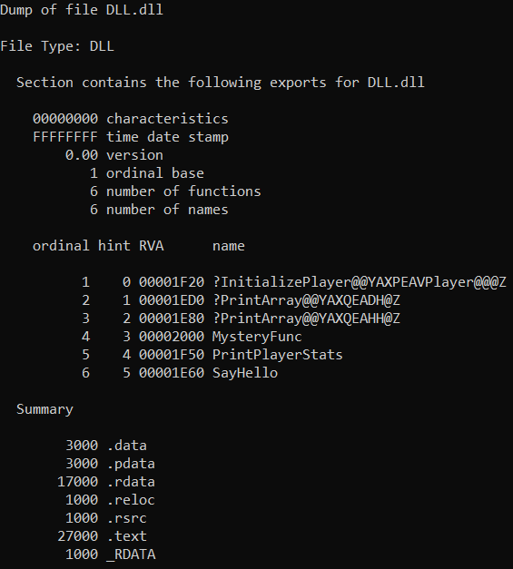
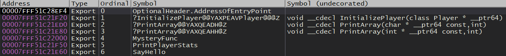

# 6.03 エクスポート

この DLL のリバースを始めましょう。この DLL を自分のプログラムに組み込みたいので、内部で何が起きているかは、あまり気にしません。気にするのは、どのエクスポートされた関数が使えるか、それらは何をするか、呼び出すために何をする必要があるかです。関数を呼び出すには、関数の型とパラメータを確実に正しくする必要があります。

## エクスポートを見つける

DLL のエクスポートを見てみましょう。これに使えるツールを 2 つ紹介します。1 つ目のツールは DUMPBIN です。これは Visual Studio に付属しています。DUMPBIN は、開発者コマンドプロンプトで使えます。開発者プロンプトを開いて、DLL のあるディレクトリに移動します。DLL のエクスポートを表示するには、コマンド `dumpbin DLL.dll /EXPORTS` を使います。

次のように表示されます:

<p>
  
</p>

x64dbg を使うこともできます。まず、DLL を x64dbg に読み込みます。読み込んだら、"Symbols" タブに進みます。"Modules" 列に DLL.dll が表示されるまで、実行ボタンを押し続けます。

x64dbg でのエクスポートは次のとおりです:

<p>
  
</p>

上に表示されている関数のすべてがエクスポートではありません。関数がエクスポートされているのか、インポートされているのかに注意してください。関数がエクスポートかインポートかは、2 列目で確認できます。

関数のエクスポートを見つけるツールは、ほかにもたくさんあります。もう 1 つの一般的な方法は、"Dependency Walker" というツールを使うことです。

## 関数のオーバーロード、マングリング、デコレーション

?PrintArray@@YAXQEAD@Z のように、いくつかの関数名にランダムな文字が付いているのは、何でしょうか? この名前のマングリング(name mangling)は、関数のオーバーロード(function overloading)のために行われます。関数のオーバーロードを使うと、同じ名前の複数の関数に、異なる実装を持たせられます。たとえば、加算のための関数が欲しいとします。おそらく、整数、float、あるいはそれらの文字列表現を加算できるようにしたいでしょう。`Add()` のような 1 つの関数名で異なる機能を提供するには、関数のオーバーロードを使えます。別の例を示します:

```c++
float Add(float x, float y){
  return x+y;
}

int Add(int x, int y){
  return x+y;
}

int main(){
  Add(2,3); //Add(int x, int y); を呼び出す
  Add(4.5, 1.2); //Add(float x, float y); を呼び出す
}
```

> 関数の名前がマングリングされているとき、それは装飾された(decorated)関数と呼ばれます。

これからリバースする DLL には、"PrintArray" という関数が 2 つあり、どちらも装飾されています。これは、それらがオーバーロードであり、一方がもう一方とは異なるパラメータを取ることを意味します。保証はありませんが、おそらく同じことをします。

装飾された関数は C の機能では*ありません*。関数が装飾されていなければ、それは C の関数です。関数宣言の前に `extern "C"` を付けることで、関数を手動で C 関数として定義できます。このため、`SayHello` などのほかの関数には、`extern "C"` が付いていると推測できます。

オーバーロードのない関数は、C 関数として定義する必要は*ありません*。見てのとおり、`InitializePlayer` は装飾されていますが、同じ名前のほかの関数はないので、上書きされることはありません。装飾された関数の良い点の 1 つは、戻り値の型とパラメータが分かることです。`InitializePlayer` は "`Player`" というクラスへのポインタを取り、void を返すことが分かります。

"__cdecl" にも気づくかもしれません。これは C Declaration の略で、呼び出し規約です。これらは C 関数なので、この接頭辞が付いていますが、cdecl 呼び出し規約に従う必要はありません。

[<- 前のレッスン](6.02%20DLLBasics.md)  
[次のレッスン ->](6.04%20SayHello.md)  

[章のトップ](6.00%20DLL.md)  
