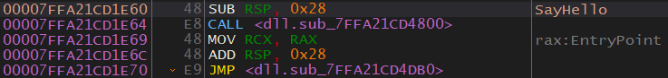
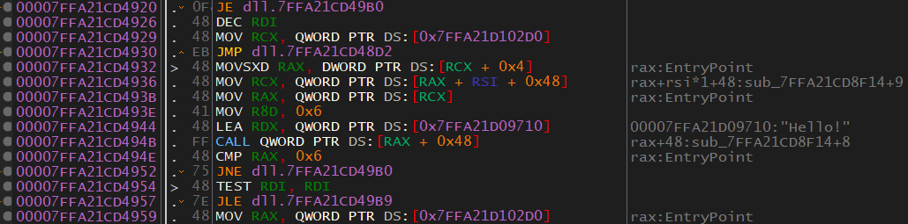
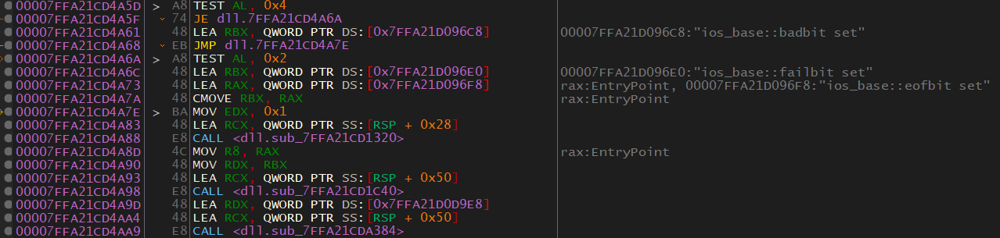
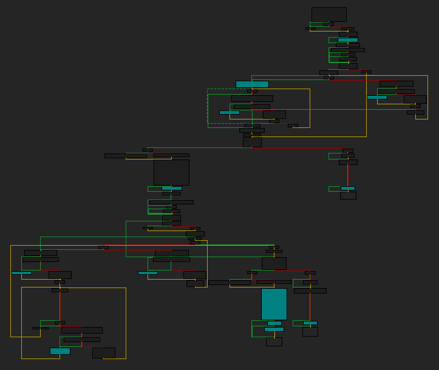
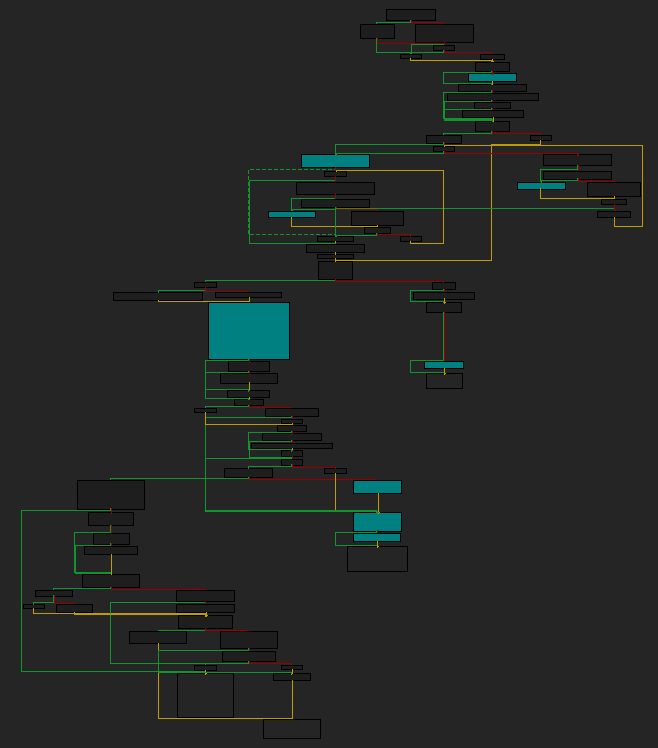
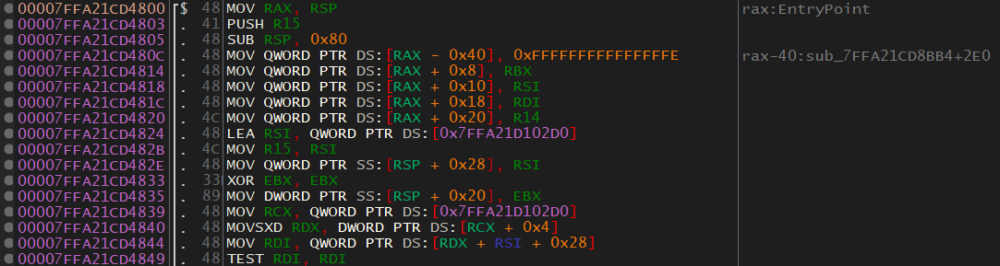
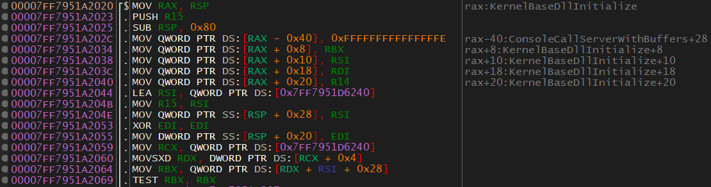
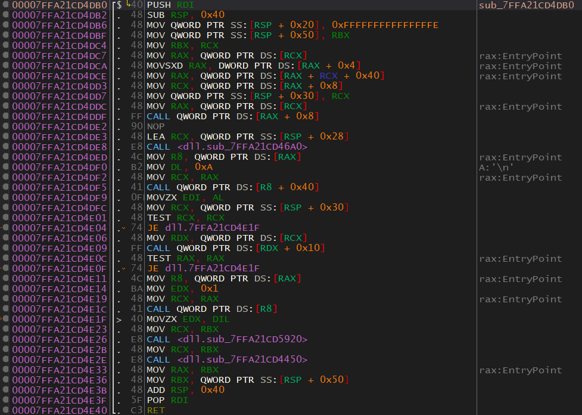
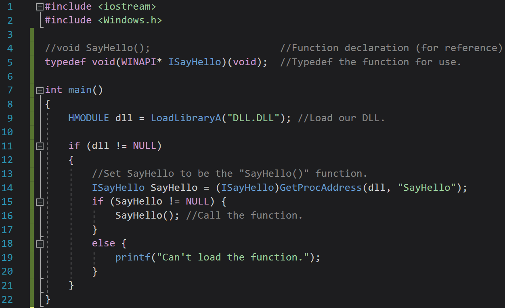
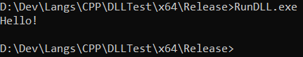

# 6.04 `SayHello()` のリバースと呼び出し

まず私がやりたいのは、その関数が何をしているのか大まかに把握することです。この関数の名前からは、「Hello」と「言う」のではないかと想像できます。単に文字列を返すだけかもしれませんし、「Hello」と出力するのかもしれません。これを念頭に置いて始めましょう。

これが `SayHello()` の逆アセンブル結果です。
<p>
  
</p>

この関数は何も返していないようです。ある関数を1つ呼び出し、別の場所へジャンプしています。最初の関数は `sub_7FFA21CD4800` です。この関数はかなり大きいです。

この関数をざっと見ていくと、2つ目に付くものがあります。関数内で文字列 `"Hello!`" が使われているのが分かります。これは関数名と明らかに関連しているので、押さえておくとよいでしょう。
<p>
  
</p>

引き続きざっと見て、ほかに役立ちそうなものがないか探してみましょう。目に付くのは、下の方に `ios_base` への参照があることです。
<p>
  
</p>

同じ関数の中に文字列「`Hello!`」と `ios_base` があるのは怪しいと感じます。これはシステムの関数、おそらく `std::cout` ではないかと思い始めています。理由は、`ios_base` が I/O ストリームの基底クラスだからです。この仮説を検証するために、`std::cout` を使う簡単なプログラムを書いて、両者が似ているかどうかを調べてみましょう。いちばん手早いのは、2つのプログラムのグラフビューを見ることです。

DLL のグラフビュー:
<p>
  
</p>

テストプログラムのグラフビュー:
<p>
  
</p>

多少は似ていますが、十分に似ているとは言えません。アセンブリを掘り下げる必要があります。まずは関数の先頭部分を見てみましょう。

DLL:
<p>
  
</p>

テストプログラム:
<p>
  
</p>

関数の先頭部分はほぼ完全に同じに見えます。この時点で、`SayHello()` が呼び出している関数は `std::cout` だとかなり確信できます。次に、`SayHello()` 関数の末尾にあるジャンプ命令を見て、何が見つかるか確認しましょう。ジャンプ先のコードは次のとおりです。
<p>
  
</p>

"\n" が使われていることと、`std::cout` が呼び出されていると考えられることから、最初の推測ではこの関数は `std::endl` です。また、`std::cout` をより簡潔にしたもののようにも見えます。

この場合、私は解明できたとほぼ確信しています。さらにリバースしたければ、続けても構いません。

# 自分のプログラムで `SayHello()` を実装する

関数のリバースができたので、今度は使ってみましょう。使う前に、その関数がどんなパラメータを取り、データ型/戻り値の型が何なのかを知る必要があります。関数を見る限り、パラメータは取らないようです。仮に取るとしても、まったく使っていません。戻り値の型についても、何も返していないようです。つまり、パラメータを取らず、型は void のようです。  

<p>
  
</p>

> このコードをコピー&ペーストできる版が、レッスンの末尾にあります。

コードを完全に理解できなくても心配はいりません。こうしたことをやったことがなければ、このコードは少し難しく感じるかもしれません。順に説明します。

* このコードは Windows ライブラリ(Windows.h)を使っています。
* typedef は、関数をデータ型として定義するために使っています。これにより、ほかの作業が楽になります。インポートした関数を「ISayHello」と名付けました。インポートされたものであることを示すために、関数名の先頭に「I」を付けています。必須ではありませんが、コードを扱いやすくするためにそうしています。また、ライブラリから関数をインポートするときに、名前の衝突なしに「SayHello」としてインポートできます。
* 9行目で DLL をインポートしています。
* 11行目の if 文で、DLL が読み込まれたことを確認しています。
* 14行目で `SayHello()` 関数をインポートしています。この関数はインポートされるとき「SayHello」という名前が付けられます。これが、「I」という命名規則を使う理由です。
* 15行目で、関数が正常に読み込まれたことを確認しています。
* 16行目で関数を呼び出しています。

このコードを実行する前に、重要なことが2つあります。

1. コードを「Release」モードでコンパイルする。
2. DLL を、私たちが書いた DLL を実行する実行ファイルと同じ場所に置く。

<p>
  
</p>

素晴らしい! ご覧のとおり、予想したとおり「Hello!」が画面に出力されました。

あなたはどう思うか分かりませんが、ドキュメントも lib ファイルもヘッダファイルもないのに、自分のコードで DLL から関数をインポートして実行できるのは、とてもすごいことだと思います。

# Copy/Paste Code(コピー&ペースト用コード)

```c++
#include <iostream>
#include <Windows.h>

//void SayHello(); //関数宣言(参考用)
typedef void(WINAPI* ISayHello)(void); //使用するために関数を typedef する。

int main()
{
 HMODULE dll = LoadLibraryA("DLL.DLL"); //DLL を読み込む。

 if (dll != NULL)
 {
  //SayHello を "SayHello()" 関数に設定する。
  ISayHello SayHello = (ISayHello)GetProcAddress(dll, "SayHello");
  if (SayHello != NULL) {
   SayHello(); //関数を呼び出す。
  }
  else {
   printf("Can't load the function.");
  }
 }
}
```

[<- Previous Lesson](6.03%20Exports.md)  
[Next Lesson ->](6.05%20PrintArray.md)  

[Chapter Home](6.00%20DLL.md)  
