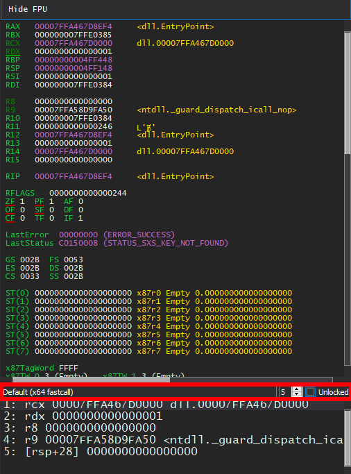
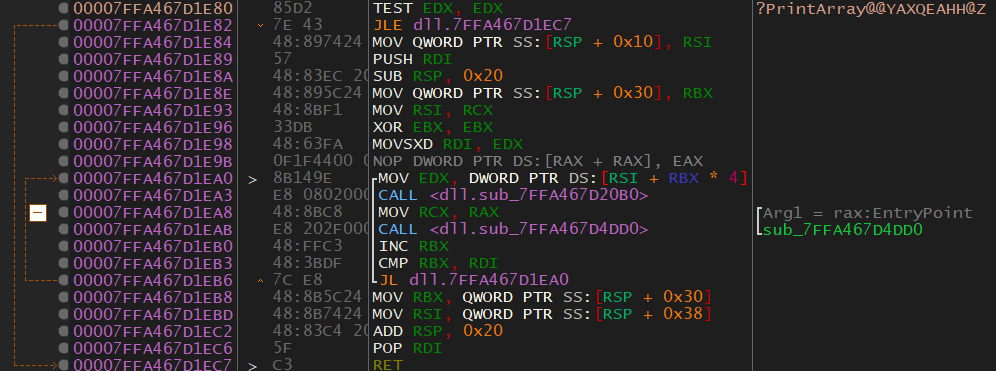
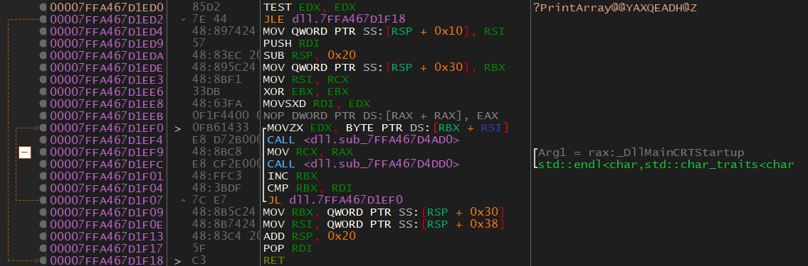
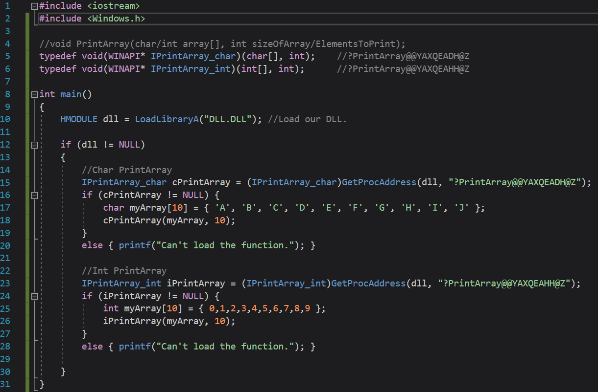
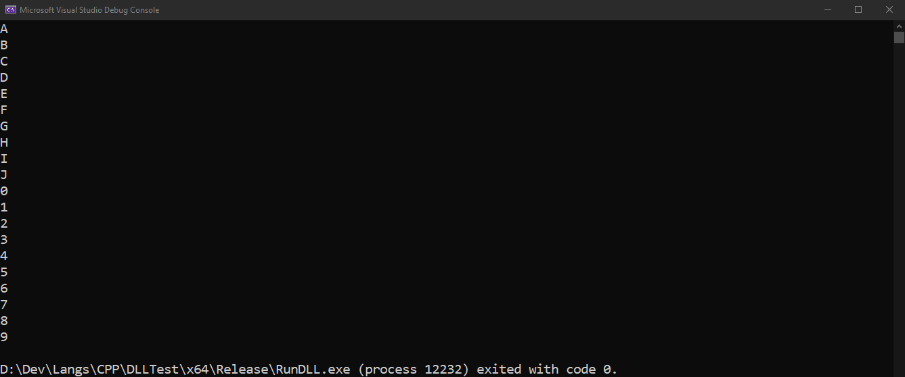

# 6.05 Print Array

`PrintArray` という関数が2つあります。両方の関数のシンボルは次のとおりです。

1. `?PrintArray@@YAXQEADH@Z`
   * void __cdecl PrintArray(char *__ptr64 const,int)
   * パラメータ:
     1. const char*
     2. int

2. `?PrintArray@@YAXQEAHH@Z`
   * void __cdecl PrintArray(int *__ptr64 const,int)
   * パラメータ:
     1. const int*
     2. int

どちらもポインタを取ることは、関数名と合致するので押さえておくとよいでしょう。配列を出力する関数なら、配列の先頭アドレスが必要になるはずです。2番目のパラメータが何なのかはまだ分かりません。思いつくのは、配列のサイズか、出力する配列要素の数のどちらかということだけです。知っておくべきリバースのアドバイスの1つは、常に全体像を忘れないことです。この関数の名前が正確なら、配列の要素を出力するはずです。これは問題解決や推測をするときに役立つので覚えておいてください。

# Lies and Deception(嘘と欺き)

エクスポートを見ると、`PrintArray` 関数は `__cdecl` で cdecl として宣言されています。つまり、これらの関数は cdecl 呼び出し規約を使っているようです。関数の逆アセンブルを見ると、最初のところで EDX を使っているのが分かります。これは極めて怪しいです。呼び出し規約が cdecl なら、なぜレジスタが使われるのでしょうか。これは cdecl ですよね…? いいえ。実はこれは fastcall のままです。なぜ fastcall だと見分けられるのでしょうか。

* `Test EDX, EDX` - これは EDX がゼロでないことを確認しています。EDX は、fastcall を使う場合に関数へ渡される2番目のパラメータです。
* `MOV RSI, RCX` - RCX が RSI に移されていますが、RCX は現在のスコープでは初期化されていません。RCX は fastcall の1番目のパラメータです。

x64dbg は実際に fastcall だと教えてくれます。x64dbg では、関数に渡されたパラメータを確認でき、さまざまな呼び出し規約でパラメータを表示できます。通常は使用する呼び出し規約を選べますが、x64dbg では fastcall しか選べません。これも(保証ではありませんが)fastcall を扱っていることを示す強い指標です。パラメータと呼び出し規約は、レジスタのウィンドウの下で確認できます。
<p>
  
</p>

このパネルが表示するパラメータの数も変更できます。

fastcall を使っていると、極めて高い確信を持てます。__cdecl という接頭辞以外に、これが cdecl だと示唆するものは何もありません。

# `PrintArray` (Int)

`PrintArray` 関数が fastcall を使っていることが分かりました。取るパラメータの型も分かっています。あとは、どう動くのか、何をするのか、パラメータは何か、何を返すのか(返すとすれば)を突き止めるだけです。デマングルした名前によると、これらの関数は何も返さない(void)はずです。まず、整数だけをパラメータに取る `PrintArray` 関数から始めましょう。これを選ぶのは、通常、整数のほうが扱いやすいからです。
<p>
  
</p>

* 最初の2行は `TEST EDX, EDX` で EDX がゼロでないことを確認しています。EDX がゼロ以下なら `dll.7FFA467D1EC7` にジャンプし、そこでは単にリターンします。ジャンプ先は、左端のオレンジ色の矢印で表されています。
* 次に RSI が RSP+0x10 に移されます。これはおそらく RSI を保存するためです。続いて RDI がスタックにプッシュされます。これはおそらく RDI を保存するためです。
* `SUB RSP, 0x20` - これはスタックを設定する関数プロローグの一部です。これを指摘するのは、RSI と RDI が保存されていたことをほぼ裏付けるからです。保存はほとんどの場合、プロローグ内かその周辺で行われます。
* RBX もおそらく保存されているだけです。RSI や RDI と同様に、fastcall では不揮発(nonvolatile)とされているので、保存する必要があります。
* `MOV RSI, RCX` - ここが、関心のある関数の「本体」部分の始まりのようです。RCX は1番目のパラメータです。RSI は、関数に渡された1番目のパラメータを保持するようになります。レジスタの章で、RSI はソースポインタとしてよく使われると述べたのを覚えているでしょうか。ここで起きているのは、まさにそれのようです。
* `XOR EBX, EBX` - EBX をゼロにします。
* `MOVSXD RDI, EDX` - EDX を RDI に移します。MOVSXD は「Move double-word to quad-word with sign-extension(符号拡張付きでダブルワードをクアッドワードへ移動)」の略です。符号拡張とは、符号(正か負か)を保ったままビット数を増やすことです。ここで重要なのは、RDI が EDX にあった値と等しくなったということだけです。EDX は2番目のパラメータだったことを思い出してください。

ちょっと補足です。ここで経験が役に立ちます。RDI と RSI が設定されていることから、これらが何らかのループで使われるのではないかと考えられます。もっと言えば、RSI にあるものを反復処理するループでしょう。確実ではありませんが、この関数の目的が配列のすべてを出力することを考えると、可能性が高そうです。

* `MOV EDX, DWORD PTR DS:[RSI + RBX * 4]` - RSI + RBX * 4 にあるものが EDX に移されます。RSI は1番目のパラメータで、これが配列(正確には配列の*先頭*のアドレス)であることは分かっています。RBX は今のところゼロです。RBX に4を掛けても結果はゼロです。今のところ無意味に見えますが、よく見るとこれはループです。これについては後でまた触れます。今は、配列(RSI)の最初の要素を EDX に入れているだけです。
* `CALL <dll.sub_7FFA467D20B0>` - この関数を掘り下げると、これまでの調査から、おそらく `std::cout` だと分かります。しかし、最初のパラメータは EDX(や RDX)ではなく RCX を通じて渡されるのではないでしょうか。`dll.sub_7FFA467D20B0` の関数の中に入ると、RCX が実際にはパラメータとして渡されたかのようには使われておらず、単に上書きされているのが分かります。一方で、EDX はパラメータのように扱われています。これはコンパイラの最適化だと考えています。`std::cout` は RCX を使って関数を呼び出すので、コンパイラは `std::cout` を呼び出すときに RCX を触らないことにして、RCX を別のレジスタに保存しなくて済むようにしたのかもしれません。これで命令がいくつか節約できます。
* `CALL <dll.sub_7FFA467D4DD0>` - これまでの調査から、これは `std::endl` だと分かります。
* `INC RBX` - RBX を1増やします。RBX はゼロで、4が掛けられていたことを思い出してください。その演算結果が、配列へのオフセットとして使われていました。これで、なぜ RBX がゼロだったのかが分かります。RBX はループの反復回数を保持しているのです。RBX は、ループの反復回数に4を掛けたインデックスにある配列の要素へアクセスするために使われます。配列を出力するプログラムを書いたことがあれば、理解できるはずです。ループの反復ごとに、ループのインデックス(反復回数)にある配列の要素にアクセスします(例: array[2]。2はループの現在の反復回数)。整数は4バイトなので、ループの反復回数に4を掛けます。
* `CMP RBX, RDI` - RBX と RDI を比較します。RBX はループの現在の反復回数を保持しており、RDI は関数の2番目のパラメータを保持するよう設定されています。つまり、2番目のパラメータとループカウンタを比較しています。この情報と、これまでの情報や仮定を合わせると、2番目に渡されるパラメータは、出力する要素の最大数か、配列のサイズだと考えられます。
* `JL dll.7FFA467D1EA0` - ループの先頭にジャンプします。

ループは続きます。array[RSI + RBX *4] にあるものを出力します。`RBX*4` について触れておきたいと思います。これは実はかなり重要です。アセンブリでは個々のバイトにアクセスできるので、こうしているのです。これは整数の配列で、各整数は4バイトです。命令 `MOV EDX, DWORD PTR DS:[RSI + RBX * 4]` は、ループの反復に対応する配列の要素を EDX に移しています。2回目の反復なら、反復回数は1です(このループはゼロから始まります)。1*4 は4です。つまり array+4 にあるものにアクセスします。整数は4バイトなので、それは2番目の要素です。ループが終わると、2番目のパラメータで指定された数の要素が出力されています。

最後に、関数エピローグです。

```asm
MOV RBX, QWORD PTR SS:[RSP + 0x30]  
MOV RSI, QWORD PTR SS:[RSP + 0x38]  
ADD RSP, 0x20  
POP RDI  
RET   
```

この関数には戻り値がないようです。RAX が一度も設定されていないからです。

## `PrintArray` Conclusion(`PrintArray` のまとめ)

`PrintArray` は、2番目のパラメータで与えられた数まで、配列の要素を出力することが分かりました。この関数は2つのパラメータを取ります。1番目のパラメータは配列で、2番目のパラメータは出力する要素数です。2番目のパラメータは配列のサイズかもしれませんが、結局は同じように動くので、実際はどちらでも構いません。

# `PrintArray` (Char)

次に、char* をパラメータに取る `PrintArray` 関数を見てみましょう。
<p>
  
</p>

この関数は、もう一方とほぼ完全に同じです。指摘したい違いは、配列の要素へのアクセスの仕方だけです。char は1バイトしかないので、整数版の `PrintArray` のように [RBX + ESI*4] (一度に4バイト)で配列の要素にアクセスする必要がありません。代わりに、[RBX + ESI] だけで要素にアクセスできます。RBX はループカウンタです。

# 自分のプログラムで `PrintArray` を実装する

コードは `SayHello` のときとほぼ同じで、データ型が違うだけです。
<p>
  
</p>

この関数の出力は次のとおりです。
<p>
  
</p>

# Final Notes(最後に)

かなりの作業量でしたが、楽しんでもらえたなら幸いです。このレッスンでは問題解決を少し体験しました。これからはもっとたくさん出てくると約束します。リバースの醍醐味の1つは、すべてを解き明かし、集めた情報すべてでパズルを組み立てることです。さあ、ここで十分な休憩を取ってください。

# Copy/Paste Code(コピー&ペースト用コード)

```c++
#include <iostream>
#include <Windows.h>

//void PrintArray(char/int array[], int sizeOfArray/ElementsToPrint);
typedef void(WINAPI* IPrintArray_char)(char[], int); //?PrintArray@@YAXQEADH@Z
typedef void(WINAPI* IPrintArray_int)(int[], int);  //?PrintArray@@YAXQEAHH@Z

int main()
{
 HMODULE dll = LoadLibraryA("DLL.DLL"); //DLL を読み込む。

 if (dll != NULL)
 {
  //Char PrintArray
  IPrintArray_char cPrintArray = (IPrintArray_char)GetProcAddress(dll, "?PrintArray@@YAXQEADH@Z");
  if (cPrintArray != NULL) {
   char myArray[10] = { 'A', 'B', 'C', 'D', 'E', 'F', 'G', 'H', 'I', 'J' };
   cPrintArray(myArray, 10);
  }
  else { printf("Can't load the function."); }

  //Int PrintArray
  IPrintArray_int iPrintArray = (IPrintArray_int)GetProcAddress(dll, "?PrintArray@@YAXQEAHH@Z");
  if (iPrintArray != NULL) {
   int myArray[10] = { 0,1,2,3,4,5,6,7,8,9 };
   iPrintArray(myArray, 10);
  }
  else { printf("Can't load the function."); }
  
 }
}
```

[<- Previous Lesson](6.04%20SayHello.md)  
[Next Lesson ->](6.06%20InitializePlayer.md)  

[Chapter Home](6.00%20DLL.md)
