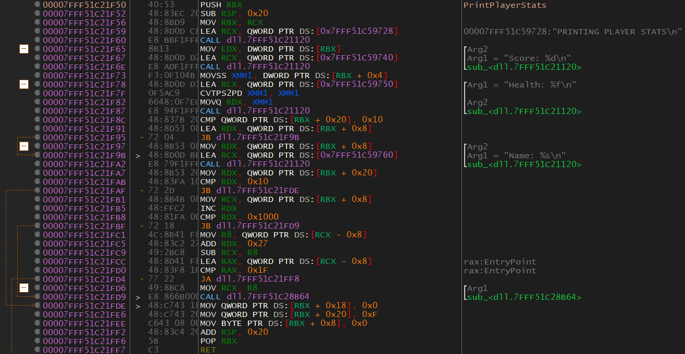
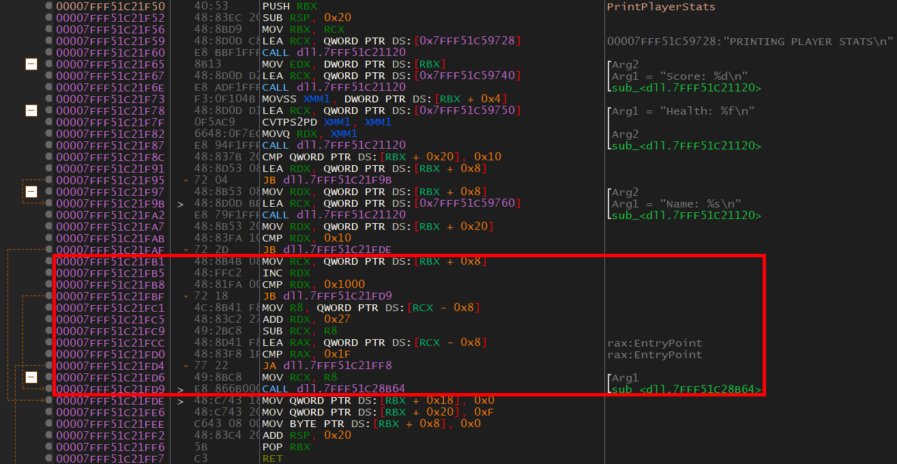

# 6.07 PrintPlayerStats

自分のプログラムで `InitializePlayer` を使う前に、このクラスについてほかにどんな情報が見つかるか調べましょう。さらに情報を探すために、`PrintPlayerStats` を見てみます。

  

この関数は実はとても単純で、`Player` に関する情報を出力するだけです。この関数は自分の力でリバースしてみてください。各行のコードが何のためにあるのかを突き止めてみましょう。

始める前にお伝えしておきたいことがあります。最後の `printf()` 呼び出しの後に、余分なコードがあります。最後の `printf()` 呼び出しの後の `JB` を辿らないと、メモリ解放のコードに入ります。興味があればこれもリバースして構いませんが、無視しても大丈夫です。

ここで話しているコードはこれです(赤枠内)。

  

ともあれ、頑張って楽しんでください! もう1つリバースしたら、この `Player` クラスを自分のコードで実装します。

[<- Previous Lesson](6.06%20InitializePlayer.md)  
[Next Lesson ->](6.08%20MysteryFunc.md)  

[Chapter Home](6.00%20DLL.md)  
