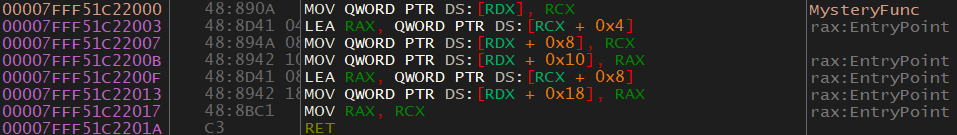

# 6.08 MysteryFunc

DLL のエクスポートを使ってリバースを紹介することにしたのは、関数名が分かっているからです。残念ながら、常にそうとは限りません。この関数はかなり小さいものですが、もうすぐ出てくるものの予告編になります。

これが `MysteryFunc` の逆アセンブルです。

<p>
  
</p>

やり方はいろいろあると示すために、この関数は少し違った方法で取り組みます。まず、実際に何が起きているのかを見て、パラメータを突き止めます。それから、その情報を解釈します。

この関数は、RCX と RDX の両方が使われているので、2つのパラメータを取るようです。

* `MOV QWORD PTR DS:[RDX], RCX` - RDX は、使われ方から何らかのデータ構造へのポインタのようです。これは、オフセット(例: +0x8)でアクセスされているということで、何らかのデータ構造の指標になります。配列やクラス(あるいはそれに似たもの)かもしれません。このコードは、RCX(1番目のパラメータ)を [RDX] (2番目のパラメータが指すアドレス)に移します。RDX は何らかのポインタです。
* `LEA RAX, QWORD PTR DS:[RCX + 0x4]` - `RCX + 0x4` のアドレスを RAX にロードします。
* `MOV QWORD PTR DS:[RDX + 0x8], RCX` - RCX(1番目のパラメータ)を RDX + 0x8 に移します。
* `MOV QWORD PTR DS:[RDX + 0x10], RAX` - RAX(RCX + 0x4 のアドレス)を RDX + 0x10 に移します。
* `LEA RAX, QWORD PTR DS:[RCX + 0x8]` - RCX + 0x8 のアドレスを RAX にロードします。
* `MOV QWORD PTR DS:[RDX + 0x18], RAX` - RAX を RDX + 0x18 に移します。
* `MOV RAX, RCX` - RCX が戻り値として RAX に移されます。このことから、この関数は何らかの構造体へのポインタを返すと分かります。この構造体は2番目のパラメータでもあることに注意してください。変更していないパラメータを返すのは奇妙ですが、そうなっています。
  
整理してみましょう。この関数は、どちらも何らかのデータ構造(構造体、クラス、配列など)である2つのパラメータを取るようです。補足ですが、データ構造が渡されるときは、先頭/ベースのアドレスだけが渡されます。関数は、そのアドレスからのオフセットで構造体内の要素にアクセスします。この関数は、データ構造の何らかの初期化/設定コードなのかもしれません。この関数の全体的な目的は、あるデータ構造から別のデータ構造へ内容をコピーすることのようです。私が面白いと思うのは、データ構造が揃っていない(aligned でない)ことです。たとえば `x[0] = x[1]` のようなものです。つまり、これは単なるデータ構造のコピー関数ではありません。余分なデータを追加しているのかもしれませんし、2つが異なる構造体なのかもしれません。新たに得た知識を踏まえて、コードを分析し直しましょう。

もう1つ見るべきはオフセットです。RDX は +8、+10、+18 のオフセットでアクセスされています。これは、最後のものを除いて、各データが同じサイズであることを示しています。RCX は +4 と +8 でアクセスされています。これも同じ状況をほのめかしています。**ここで重要なのは、RDX のオフセットは8間隔で、RCX の要素は +4 のオフセットだと理解することです。**

* `MOV QWORD PTR DS:[RDX], RCX` - RCX のデータ構造のアドレスが、RDX のデータ構造の最初の要素に入れられます。
* `LEA RAX, QWORD PTR DS:[RCX + 0x4]` - RCX のデータ構造内の2番目のパラメータのアドレスが RAX に移されます。RAX は、アドレスを構造体に移すための仲介役として使われています。`MOV [RDX + 0x8], [RCX + 0x4]` のようなものは有効な命令ではないためです。アセンブリはそういうものです。
* `MOV QWORD PTR DS:[RDX + 0x8], RCX` - RCX が RDX のデータ構造の2番目の要素に移されます。これが3番目ではなく2番目の要素だと分かるのは、(オフセット +0x0、+0x4、+0x8 に4バイトの整数要素が3つある場合なら3番目になりますが)RDX の最初の要素がアドレス(具体的には RCX のデータ構造のアドレス)だからです。この DLL は64ビットなので、アドレスはおそらく64ビット(8バイト)です。つまり、最初の要素は4バイトではなく、64ビット(8バイト)のアドレスです。
* `MOV QWORD PTR DS:[RDX + 0x10], RAX` - RAX(RCX のデータ構造の2番目の要素のアドレス)を、RDX のデータ構造の3番目の要素に移します。
* `LEA RAX, QWORD PTR DS:[RCX + 0x8]` - RCX のデータ構造の3番目の要素のアドレスを RAX に移します。
* `MOV QWORD PTR DS:[RDX + 0x18], RAX` - RAX(RCX のデータ構造の3番目の要素のアドレス)を、RDX のデータ構造の4番目の要素に移します。
* `MOV RAX, RCX` - 1番目のパラメータ、つまり RCX のデータ構造のアドレスを返します。繰り返しますが、RCX には変更されていないパラメータが入っている(ではなぜ返すのか)うえ、RCX はすでに RDX のデータ構造にコピーされているので、これは奇妙です。無意味、奇妙、あるいは冗長に思えるかもしれませんが、リバースしていると意外なものを目にします。

つまり基本的に、RDX の構造体には、RCX のデータ構造の要素へのポインタが順番に入っています。また、構造体自身へのポインタも入っていますが、最初の要素が構造体のアドレスと同じなので、冗長です。でも、そうなっているのです。データ構造は揃っていないので、異なる構造体です。また、RCX のデータ構造のオフセットは +4 で、RDX のオフセットは +8 だと分かっています。

さあ、だんだん筋が通ってきました! それでも、データ構造が何なのかはまだ分かりません。クラスかもしれませんし、配列、あるいはその他のデータ構造かもしれません。実際には、クラスと配列の違いはとても小さいです。起きていると推測できることを、疑似コードで見てみましょう。

どちらもクラスの場合:

```c++
class OldClass{
public:
    int x, y, z;
};
class NewClass {
public:
    int* addrOfOldClass;
    int *x, *y, *z;
};

void* CopyClass(OldClass* oldClass, NewClass* newClass) {
    newClass->addrOfOldClass = oldClass;
    newClass->x = (int*)&oldClass->x;
    newClass->y = (int*)&oldClass->y;
    newClass->z = (int*)&oldClass->z;
    return oldClass;
}

int main() {
    OldClass oldClass;
    oldClass.x = 10;
    oldClass.y = 20;
    oldClass.z = 30;

    NewClass newClass;
    CopyClass(&oldClass, &newClass);
}
```

どちらも配列の場合:

```c++
void* CopyArray(int oldArray[], void* newArray[]) {
    newArray[0] = &oldArray; //oldArray のアドレス
    newArray[1] = &oldArray[0]; //oldArray のアドレス[0]
    newArray[2] = &oldArray[1];
    newArray[3] = &oldArray[2];
    return &oldArray;
}

int main() {
    int myArray[3] = { 1,2,3 };
    void* addrArray[4]; //ポインタの配列
    CopyArray(myArray, addrArray);
}
```

これで、`MysteryFunc` が何をしているか理解できたことを願います。

## この関数の実際のコード
>
> `extern "C" __declspec(dllexport)` は無視して構いません。`__declspec(dllexport)` は関数を DLL のエクスポートとして定義し、`extern "C"` は名前修飾(name mangling)を防ぎます。リバースしている DLL は私が書いたので、ソースコードを入手できました。

```c++
class Player {
public:
    int score;
    float health;
    std::string name;
};

void* MysteryFunc(Player* player, int* arr[]) {
    arr[0] = (int*)player;
    arr[1] = (int*)&player->score;
    arr[2] = (int*)&player->health;
    arr[3] = (int*)&player->name;
    return player;
}
```

ご覧のとおり、ほぼ的中しました。実際のコードから、クラスと配列の両方が使われていたことが分かります。より正確には、クラスの内容が配列にコピーされています。この場合、静的解析だけでは、パラメータがクラスなのか配列なのかを知る方法はありませんでした。低レベルでは、構造体も配列も同じ方法でアクセスされます。パラメータがデータ構造であることは分かりましたが、どの種類かは分かりようがありませんでした。もっと正確にする唯一の方法は、その DLL を使うプログラムをデバッグして、`MysteryFunc()` がどう使われているかを分析することでした。

このレッスンは楽しめました。この種の問題やパズルを解くことが、私がリバースをとても楽しんでいる理由です。これは簡単な例でした。まもなく、もっと複雑な例を見ていくことをお約束します。

[<- Previous Lesson](6.07%20PrintPlayerStats.md)  
[Next Lesson ->](6.09%20ImplementingPlayer.md)  

[Chapter Home](6.00%20DLL.md)
