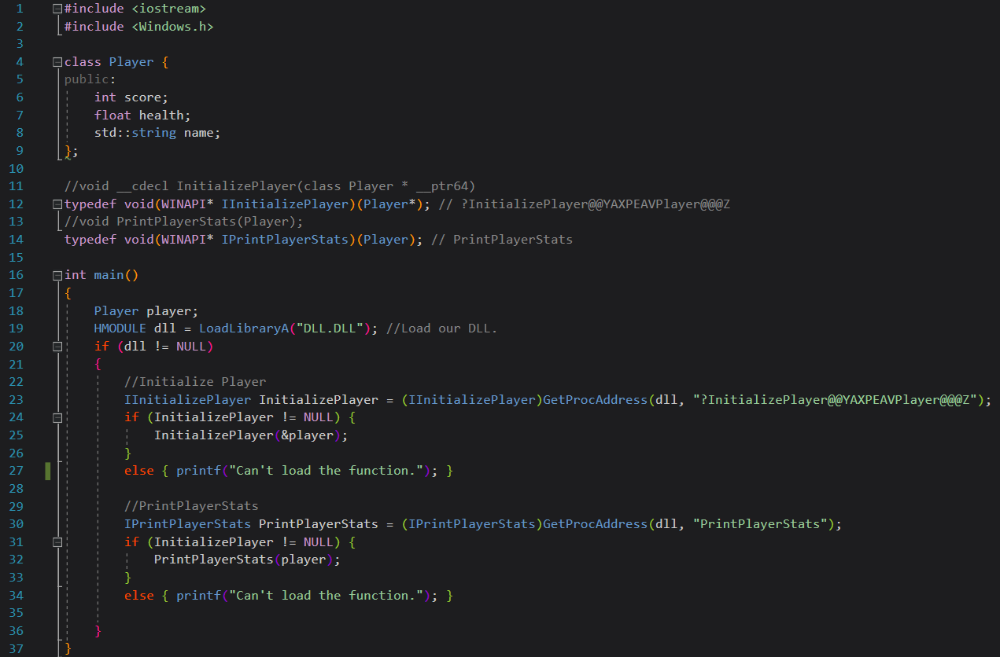

# OPTIONAL: 6.09 `Player` の実装

`Player` クラスのリバースができたので、`Player` クラスを作り、そのクラスに関連する関数を使う自分のプログラムを書いてみましょう。

<p align="center">
  
</p>

プレイヤーの名前は `std::string` である必要はなく、おそらく `const* char` でも構いません。

# Copy/Paste Code(コピー&ペースト用コード)

```c++
#include <iostream>
#include <Windows.h>

class Player {
public:
    int score;
    float health;
    std::string name;
};

//void __cdecl InitializePlayer(class Player * __ptr64)
typedef void(WINAPI* IInitializePlayer)(Player*); // ?InitializePlayer@@YAXPEAVPlayer@@@Z
//void PrintPlayerStats(Player);
typedef void(WINAPI* IPrintPlayerStats)(Player); // PrintPlayerStats

int main()
{
    Player player;
    HMODULE dll = LoadLibraryA("DLL.DLL"); //DLL を読み込む。
    if (dll != NULL)
    {
        //Initialize Player
        IInitializePlayer InitializePlayer = (IInitializePlayer)GetProcAddress(dll, "?InitializePlayer@@YAXPEAVPlayer@@@Z");
        if (InitializePlayer != NULL) {
            InitializePlayer(&player);
        }
        else { printf("Can't load the function."); }

        //PrintPlayerStats
        IPrintPlayerStats PrintPlayerStats = (IPrintPlayerStats)GetProcAddress(dll, "PrintPlayerStats");
        if (InitializePlayer != NULL) {
            PrintPlayerStats(player);
        }
        else { printf("Can't load the function."); }
    }
}
```

[<- Previous Lesson](6.08%20MysteryFunc.md)  
[Next Lesson ->](6.10%20FinalNotes.md)  

[Chapter Home](6.00%20DLL.md)  
