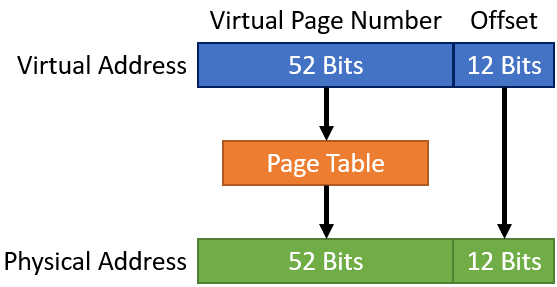
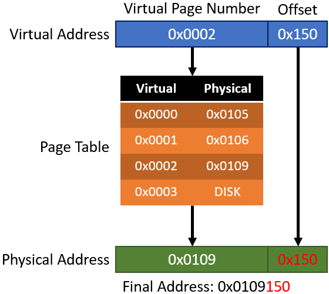

# 7.1 Virtual Memory(仮想メモリ)

コンピュータには、RAM とも呼ばれる**物理メモリ**(physical memory)があることはご存じでしょう。では、このメモリにはどのようにアクセスするのでしょうか。もちろん、アドレスです! しかし残念ながら、そう単純ではありません。

* システム上で複数のプロセスが動いている場合、各プロセスのメモリ領域を指定する方法が必要です。
* 容量の問題にも直面し始めます。物理メモリが4GBしかないのに、動いているプロセスが6GB必要としたらどうするのでしょうか。
* プログラムが実行のたびに同じアドレス空間に読み込まれるとは限らないなら、ハードコードされたアドレスは使えません。
* フラグメンテーション(断片化)はどうでしょうか。小さなプログラムが終了して、その空いたメモリ領域に新しいプロセスを入れる余裕がなければ、その分は無駄な領域になります。その空間に収まるほど小さいプロセスがあっても、同じサイズでない限り、未使用のメモリが残ります。

これらの問題や、そのほか多くの問題を解決するために、各プロセスがシステム上で唯一のプロセスであるかのように動作できたらどうでしょうか。ここで仮想メモリが登場します。

## What Is Virtual Memory(仮想メモリとは)

仮想メモリを使うと、各プロセスは、自分だけが実行されていて、システムのすべてのメモリにアクセスできるという錯覚の下で動作できます。

この錯覚を実現するために、プロセスは、物理メモリ上の実際の読み込み先に関係なく、0x40000000 などの特定のアドレスに読み込まれているかのように動作します。プロセスが自分の置かれていると考えているメモリのことを**仮想メモリ**(virtual memory)と呼びます。プロセスがメモリにアクセスしようとするとき、アクセスしているのは仮想メモリです。プロセスがアクセスしようとしているアドレスは、**メモリ管理ユニット(Memory Management Unit、MMU)**によって、仮想アドレスから物理アドレスに変換されます。

### **Example(例):**

プロセスは自分が 0x40000000(仮想メモリ)で動いていると考えていますが、実際には 0x20005000(物理メモリ)にあります。プログラムが仮想アドレス 0x40000**124** にアクセスしようとすると、MMU はそれを物理アドレス 0x20005**124** に変換します。これは、プロセスがオフセット 0x124 にあるアドレスにアクセスしようとしていることをシステムが認識するために行われます。

これにより、プログラムをメモリ内のどこにでも(ほかのプロセスがそこに読み込まれていない限り)読み込むことができ、自分だけのプロセスであるかのようにメモリを使えます。

仮想メモリのもう1つ面白い点は、プロセスをチャンク(塊)ごとにマップできることです。たとえば、プロセスの一部が 0xB0004500 から 0xB000F000 にあり、別の一部が 0xD0100000 から 0xD010C000 にあるといったことが可能です。別のプロセスを、その2つのチャンクの間、たとえば 0xC0000000 から 0xD0000000 に置くこともできます。

仮想メモリについてぼんやりと理解できたところで、もう少し詳しく見ていきましょう。

## Pages(ページ)

物理メモリのアドレスを1つずつ仮想メモリのアドレスにマップすると、皮肉なことに、メモリを使いすぎてしまいます。そこで、物理メモリは通常、**ページ**(pages)と呼ばれる4KBのチャンクに分割され、それが仮想アドレスにマップされます。これらのページとその情報は**ページテーブル**(page tables)に格納されます。ページはかなり複雑ですが、ここでは単純な理解だけで十分です。また、ページには小さいものと大きいものがあり、それぞれ4KBと2MBです。大きいページは通常、Windows のコアコンポーネントや I/O に使われます。

これらのページの物理アドレスから仮想アドレスへのマッピングは、**メモリ管理ユニット(MMU)**が行います。MMU は物理的なハードウェアで、一般的なデスクトップコンピュータではプロセッサ内にあります。

### Protections(保護)

各ページには、読み取り、書き込み、実行、またはそれらの組み合わせといった権限が設定されています。たとえば、データを含むページは読み取り/書き込みとして設定されるかもしれません。1つのページにデータと実行可能なコードの両方が含まれる場合は、問題になることがあります。その場合、ページ全体を読み取り/書き込み/実行として設定しなければならなくなります。

### Page States(ページの状態) - **WIP**

仮想アドレス空間のページは、空き(free)、予約済み(reserved)、コミット済み(committed)、共有(shared)のいずれかになります。コミット済みと共有可能なページは「通常の」ページで、どちらも物理メモリ上の有効なページにマップされます。コミット済みのページは、プロセス間で共有できない点が少し異なります。代わりに、それらはプライベートで、1つのプロセスだけにコミットされています。そのため、コミット済みのページはプライベートページとも呼ばれます。

## Address Translation(アドレス変換)

ここからが面白いところで、仮想アドレスが物理アドレスにマップされる仕組みです。

各テーブルエントリは2つの部分に分けられます。下位12ビットがページオフセットです。残りが仮想ページ番号です。残りの12ビットは変換されず、代わりにオフセットとして扱われます。

  

次は例です(理解しやすいように簡略化してあり、完全に正確ではありません)。

  

起きていることを順に説明します。

* プロセスは 0x0002150 にアクセスしようとしています。
* ページテーブルで検索されるアドレス(仮想ページ番号)は 0x0002 です。
* オフセットは 0x150 です。
* 0x0002 がページテーブルで検索され、0x0109 に変換されます。
* 0x0109 にオフセット 0x150 が加えられます。
* 結果は 0x0109150 です。

物理アドレスの一覧に「DISK」があることにも気づくかもしれません。これは、物理メモリが足りないとき、ページをディスクに置けるためです。

以上が仮想メモリの基本です。あまり辛くなかったことを願います。

## You Don't Have Enough RAM(RAM が足りない)

x86 では、各プロセスは4GBのメモリがあると伝えられ、半分がカーネルモード用、残り半分がユーザーモード用です。これだけでも、かなり明白な問題が生じます。わずか20個のプロセスが動いているだけで、100GBの RAM が必要になります。しかも、さらに悪化します。最近の x64 Windows では、各プロセスに128TBのメモリが許されています。皮肉なことに、Windows Server 2016/2018 Datacenter は24TBまでしかサポートしていません。もちろん、プロセスがその領域を使うことはおそらくありませんが、それでもかなり興味深いことです。仮想メモリのおかげです!

### Other Explanations(そのほかの解説)

仮想メモリを扱っているそのほかの資料です。

* <https://courses.cs.washington.edu/courses/cse378/09au/lectures/cse378au09-23.pdf>
* <https://www.youtube.com/playlist?list=PLiwt1iVUib9s2Uo5BeYmwkDFUh70fJPxX>
* <https://www.youtube.com/watch?v=2quKyPnUShQ>
* <https://www.bottomupcs.com/virtual_addresses.xhtml>

[<- Previous Lesson](7.0%20Windows.md)  
[Next Lesson ->](7.2%20Privileges.md)  

[Chapter Home](7.0%20Windows.md)
