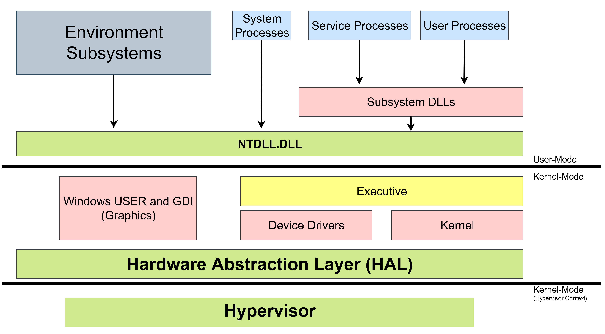

# 7.3 Architecture(アーキテクチャ)

すでに説明したように、Windows はカーネルモードとユーザーモードを分離しています。しかし、Windows はそこで終わりではありません。ほかにもさまざまなコンポーネントが分離され、構造のような形で整理されています。Windows はオブジェクト指向の設計で作られていますが、カーネルモードのコンポーネントでは、ほとんどすべてが一緒に動作しているため、それがより明確に表れています。ユーザーモードは、ほとんどのコンポーネントが連携して動作しないため、それほどオブジェクト指向ではありません。

このオブジェクト指向の設計は、コンポーネントに関するものであって、必ずしも基になるコードに関するものではないことを指摘しておく必要があります。システムのコンポーネントはオブジェクト指向的に動作しますが、OS は C 言語で書かれており、C は*オブジェクト指向プログラミング*(OOP)言語ではありません。これは低レベルの構造体を見るとはっきりします(C にはクラスがありません)。C の構造体には、OOP の機能が一切ありません。C には、構造体の継承、メソッド、コンストラクタなどはありません。

### Service vs Process(サービスとプロセス)

サービスとプロセスの違いを知っておくことは重要です。Windows のサービスは、いわゆるデーモンです。デーモンは、バックグラウンドで動作し、ユーザーではなく OS によって制御されるプログラムです。プロセスも似ていますが、ユーザーが起動したり、やり取りしたりできる点が異なります。プロセスの例はログオンプロセスです。サービスの例はユーザーマネージャーです。ログオンプロセスとは、ユーザー名とパスワードを入力してやり取りします。ユーザーマネージャーとはやり取りせず、バックグラウンドでユーザーを管理しています。あるものをプロセスとサービスのどちらかに定義するのは難しいことがあり、サービスだと思うようなプロセスや、プロセスだと思うようなサービスがよくあります。

## Layout(レイアウト)

次は、Windows のアーキテクチャのレイアウトを簡略化して示したものです。  

  

まず、カーネルモードとユーザーモードが分離されていることに注目してください。また、ハイパーバイザは独自のカーネルモードのコンテキストで示されていますが、ハイパーバイザは通常のカーネルモードで動作することに注意してください。

### User-Mode(ユーザーモード)

* **Environment Subsystems(環境サブシステム)** - これは基本的に、ユーザーやプログラマーに提示されるものです。OS のユーザーやプログラマーに提示される、環境全体/パーソナリティの基盤となる実装と考えてください。主要なサブシステムは Windows、POSIX、OS/2 の3つです。OS/2 は Windows 2000 を最後に使われました。POSIX は*Subsystem for Unix-based Applications*(SUA)に置き換えられ、それがさらに*Windows Subsystem for Linux*(WSL)に置き換えられました。
* **User Processes(ユーザープロセス)** - ユーザーモードで起動され実行される、従来型のプロセス。
* **Service Processes(サービスプロセス)** - *タスクスケジューラ*(Task Scheduler)などの Windows サービスをホストします。通常、これらは OS とともに動作するため、ユーザーがログインしているかどうかは関係ありません。OS が動いていれば、これらも動いています。
* **System Processes(システムプロセス)** - 固定の/ハードコードされたプロセス(サービスではない)。

サービスやユーザープロセスが、サブシステム DLL を「通して」動作していることに気づくかもしれません。これは、ユーザーモードのアプリケーションが、ネイティブの Windows OS サービスを直接呼び出さないためです。代わりに、サブシステム DLL を経由します。これらの DLL の役割は、ドキュメント化された公開の関数呼び出しを、内部の(通常はドキュメント化されていない)ネイティブのシステム関数に変換することです。これらの関数/サービスのほとんどは NTDLL.dll に実装されています。

### Kernel-Mode(カーネルモード)

* **Windows USER and GDI (Graphics)** - 低レベルの GUI 関数。
* **Executive** - エグゼクティブには、メモリ管理、プロセス管理、I/O など、主要な OS サービスが含まれます。
* **Device Drivers(デバイスドライバ)** - ハードウェア、ネットワーク、I/O のドライバなど。
* **Kernel(カーネル)** - Windows カーネルには、低レベルの OS コードが含まれます。カーネルは、マルチプロセッサの同期、割り込みのスケジューリングとディスパッチ、例外のディスパッチなどを管理します。
* **HAL** - *ハードウェア抽象化レイヤー*(Hardware Abstraction Layer、HAL)は、ハードウェアをシステムのほかの部分から分離します。ハードウェアの違いを OS から隠します。
* **Hypervisor(ハイパーバイザ)** - ハイパーバイザは基本的に自己完結しています。独自のメモリマネージャーのようなものまで含んでいます。

## Core Windows Files(Windows の主要ファイル)

(この表の出典は「Windows Internals」です)。

Name|Components
---|---
ntoskrnl.exe|エグゼクティブとカーネル。
hal.dll|HAL
win32k.sys|カーネルモードの GDI サポート。
hvix64.exe (Intel), hvax64.exe (AMD)|ハイパーバイザ
\SystemRoot\System32\Drivers 内の .sys ファイル|コアドライバファイル。
ntdll.dll|エグゼクティブ関数のための内部サポート関数。
kernel32.dll, advapi32.dll, user32.dll, gdi32.dll|コアのサブシステム DLL。

[<- Previous Lesson](7.2%20Privileges.md)  
[Next Lesson ->](7.3%20Architecture.md)  

[Chapter Home](7.0%20Windows.md)

##### Sources(出典)

Yosifovich, Pavel, et al. *Windows Internals. System Architecture, Processes, Threads, Memory Management, and More.* Microsoft Press., 2017.
